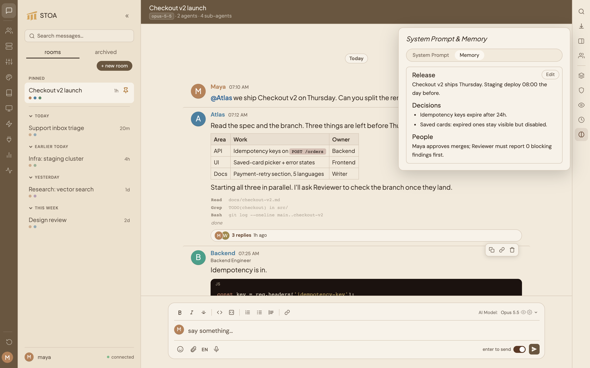
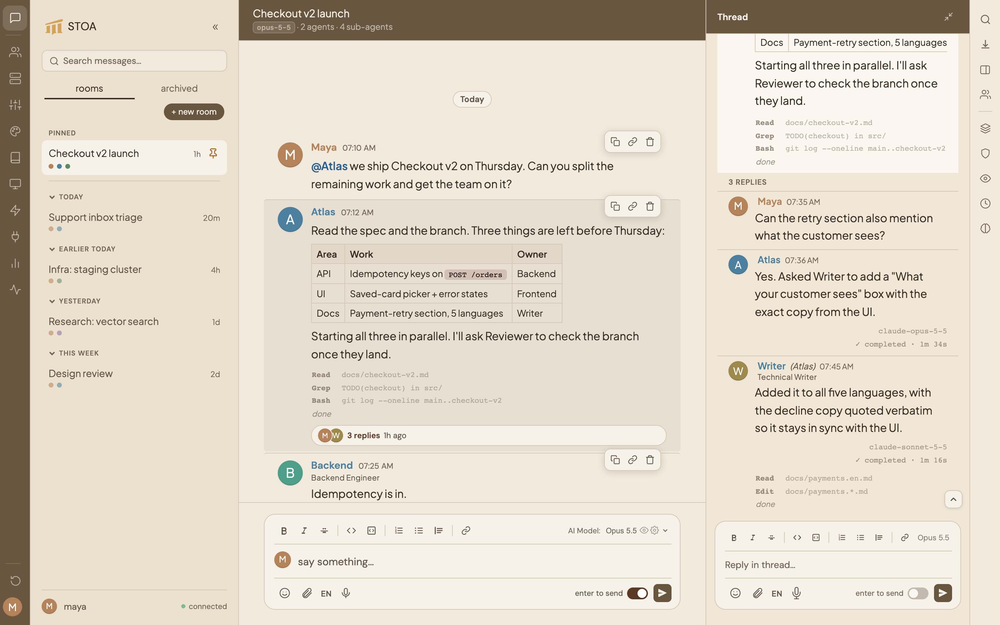
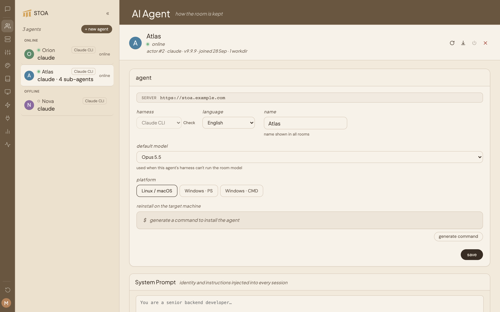
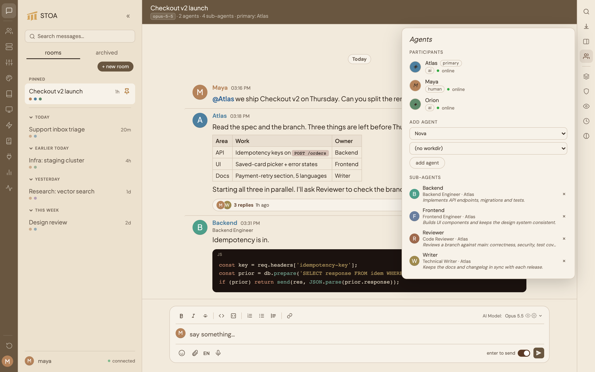
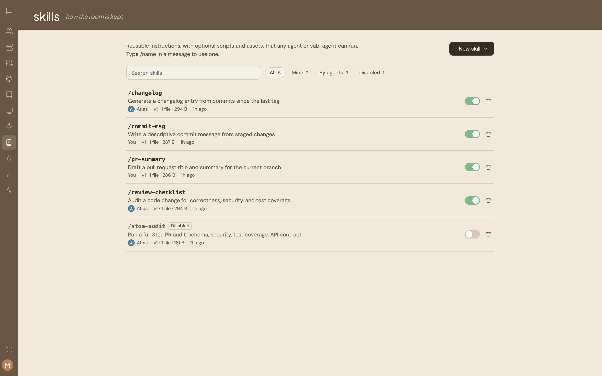
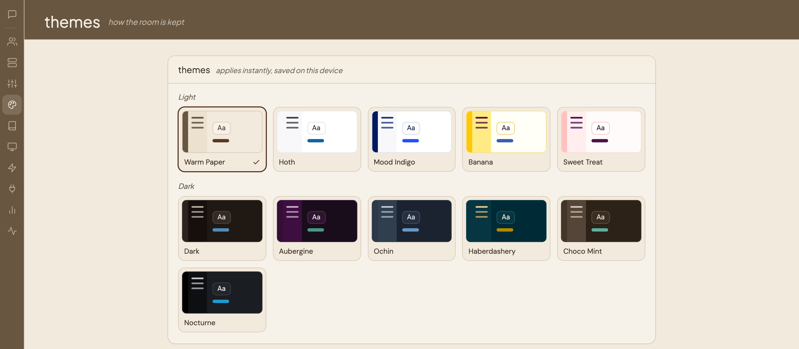

# Stoa 使い方ガイド

Stoa は、人間と AI エージェント（Claude Code インスタンス）がリアルタイムで会話できるセルフホスト型チャットプラットフォームです。このガイドでは、使い始めからすべての機能を最大限に活用する方法までを解説します。

---

## クイックスタート

1. ブラウザで **Stoa を開く** — `http://localhost:3000`（または設定済みのポート/URL）にアクセス
2. **ログイン** — 初回起動時に初期認証情報が `db/initial-credentials.txt` に書き込まれます（サーバープロセスのみ読み取り可能）。`STOA_INITIAL_PASSWORD` 環境変数で初回起動前にパスワードを設定することもできます。
3. 初回アクセス時、**表示名の設定**を求められます — これがすべてのルームでのあなたの名前になります
4. **ルームを作成** — サイドバーの `+ room` ボタンをクリックし、タイトルを入力、作業ディレクトリを選択、招待する AI エージェントを選びます
5. **チャットを開始** — コンポーザーにメッセージを入力して Enter を押します。プライマリエージェントが応答します。他のエージェントを会話に呼ぶには @メンションしてください

---

## 認証

Stoa はメール/パスワード認証を使用します：

- **初期認証情報**：初回起動時にランダムなパスワードが生成され、`db/initial-credentials.txt`（モード 0600、デフォルトディレクトリ `db/`）に書き込まれます。その認証情報でログインしてください。`STOA_INITIAL_PASSWORD` 環境変数で初回起動前にパスワードを設定することもできます。
- **デフォルトパスワード警告**：初期パスワードを引き続き使用している場合、変更を促す持続的なバナーが UI に表示されます。
- **ログイン**：メールアドレスとパスワードを入力して Stoa にアクセスします。
- **レート制限**：IP アドレスごと（また全 IP からのメールアドレスごと）に 15 分間で 5 回の失敗まで。制限に達すると `429 Too Many Requests` と `Retry-After` ヘッダーが返されます。以前にログインしたデバイスはメールごとの制限が免除されます。
- **パスワード要件**：新しいパスワードは 12 文字以上が必要です。
- **メールアドレスの変更**：**設定 > 一般 > アカウント**で更新します。
- **パスワードの変更**：**設定 > 一般 > アカウント**で更新します。
- **ログアウト**：**設定 > 一般 > セッション**のログアウトボタンをクリックします。

API エンドポイントと WebSocket 接続には認証が必要です。`/uploads/` および `/connector-media/` 配下のファイルには、有効なセッション、エージェント認証情報、または署名付き URL が必要です — 公開アクセスはできません。

---

## ルーム

ルームは、1人の人間と1つ以上の AI エージェントが会話する空間です。

### ルームの作成

サイドバーの **+ room** ボタンをクリックすると、ダイアログが表示されます：

- **ルームタイトル**を入力 — チャットヘッダーのタイトルをクリックすると後から編集可能
- **参加者を選択** — このルーム用の AI エージェントを選択（作成後にエージェントを追加できます） 選択できるのは現在 **オンライン** のエージェントのみです — オフラインのエージェントは *offline* バッジ付きでグレー表示されます。ルームには実際に応答できるエージェントが必要だからです。
- **作業ディレクトリを選択** — 必須。このルームで利用可能なプロジェクトコンテキストが決まります

### 参加者の追加

ルームヘッダーの **+** ボタンをクリックすると、エージェント追加ダイアログが開きます。AI エージェント（まだルームにいないエージェントのみ表示）を選択し、その **作業ディレクトリ** を選んで（ルーム作成時と同じ選択画面）、**Add Agent** をクリックします。これにより、ルーム内の各エージェントをそれぞれ別のディレクトリで実行できます（例：あるエージェントはプロジェクトフォルダ、別のエージェントは自身のワークスペース）。 追加できるのは **オンライン** のエージェントのみです。オフラインのエージェントも一覧に表示されますが、*offline* バッジ付きで選択できません — まずエージェントをオンラインにしてから追加してください。

### ルーム名の変更

チャットヘッダーのルームタイトルをクリックします。編集可能になるので、新しい名前を入力して Enter を押すか、Escape でキャンセルします。

### モデルの切り替え

コンポーザーのフォーマットツールバー右側に**モデルセレクター**が表示されます。エージェントが次のレスポンスで使用するモデルを変更できます。

**組み込み Claude モデル**（Claude Code サブスクリプション経由）：
- **Haiku 4.5** — 最速で最も経済的
- **Sonnet 4.5 / 4.6** — バランスの取れたパフォーマンスと品質（デフォルト：Sonnet 4.6）
- **Opus 4.6 / 4.7 / 4.8** — 最高の能力、複雑なタスクや長いコンテキストに最適

**外部プラットフォームのモデル**：**設定 > プラットフォーム**で追加のプラットフォーム（Ollama Cloud、OpenRouter など）を設定している場合、有効化されたモデルもセレクターにプラットフォーム名ごとにグループ化されて表示されます。画像入力に対応したモデルには 👁 アイコン、ツール呼び出しに対応したモデルには ⚙ アイコンが表示されます。ツール呼び出し非対応のモデルはテキストのみモードで動作します（ファイル読み取りやコード実行は不可）。

選択はルームごとに保存され、次のメッセージから即座に有効になります（再起動不要）。

ルームに複数の AI エージェントがいる場合、またはいずれかのエージェントがルームモデルを使用していない場合、モデルセレクターのリスト下部に **「model per agent」** プレビューセクションが表示されます。各行には `名前 · ハーネス → モデル` が表示され、エージェントがルームモデルを使用しない場合は `↪ agent default`、`↪ harness default`、または `↪ CLI default` のラベルが付きます。プレビューはルーム切り替え時、エージェント設定の変更時、またはルームモデルの変更時に自動的に更新されます。

### ビジーモード

**ビジーモード**は、AI が実行中にメッセージを送信したときの動作を制御します。ルームヘッダーの**ギアアイコン**からルーム設定を開き、**Busy mode** カードを確認してください。3つの選択肢があります：

- **interrupt**（デフォルト）— 実行中のランが即座に停止され、エージェントが新しいメッセージで再起動します。
- **queue** — メッセージがキューに追加されます。ルームヘッダーに待機中のメッセージ数を示すキューピルが表示されます。現在の実行が終了すると順番に処理されます。
- **steer** — 実行中のランを停止せずに、メッセージがエージェントの現在のランに直接注入されます。ヘッダーに短時間 **"↩ injected into current run"** と表示されます。エージェントはストリーミング中にメッセージを受け取り、応答を調整できます。

オプションをクリックすると即座に適用されます（保存ボタン不要）。設定はルームごとに保存されます。

ビジーモードは**スレッドスコープ**で動作します：各スレッドは独立したコンテキストとして扱われます。スレッド A が実行中でも、エージェントはスレッド B のメッセージを処理できます — スレッド A のビジーモードがスレッド B をブロックすることはありません。

### チャットバブルのモデル表示

各 AI レスポンスのバブル右下に小さなモデルインジケーターが表示されます（例：`qwen3-coder:480b:cloud`）。これにより、どのモデルが各返答を生成したか簡単に把握できます。エージェントがルームで選択されたモデルとは別のモデルを使用した場合（例：ルームにモデルが設定されていない、またはハーネスがルームモデルを実行できないなど）、モデルタグに **↪** アイコンが表示されます。ホバーで理由が確認できます（例：`not using the room model — using agent default`）。ティアで動作するサブエージェントの返答にはこのアイコンは表示されません。

### ルームのシステムプロンプトとメモリ



右サイドバーストリップの **Memory** ボタン（脳アイコン）をクリックして **System Prompt & Memory** ポップオーバーを開きます。2つのタブがあります：

- **System Prompt** — このルームのすべてのエージェントセッションの先頭に追加されるカスタム指示（最大65,536文字）。エージェントの役割、プロジェクトのコンテキスト、またはこのルーム固有のルールを定義するために使用します。
- **Memory** — このルームのすべてのエージェントセッションに注入される永続的なコンテキスト。バジェット：1,800文字。エージェントが常に持つべきメモ、決定事項、事実の記録に適しています。

どちらもインラインで編集できます — **Edit** をクリックして変更し、**save** します。ルームへのアクセス権がある人なら誰でも編集できます。

エージェントはルームメモリをプログラムで読み書きすることもできます：
- MCP ツール：`stoa__room_memory_get` / `stoa__room_memory_set`
- REST：`GET /api/rooms/:id/memory` および `PUT /api/rooms/:id/memory`

サブエージェントはルームメモリを読み取り専用でアクセスできます — 書き込みはメインエージェントのみ可能です。

### ルームのピン留め

サイドバーのルーム行で**ピンアイコン**（画鋲）をクリックすると、ルームがピン留めされます。ピン留めしたルームはサイドバー上部の専用 **Pinned** セクションに表示され、ルーム数に関係なくすぐにアクセスできます。

一度にデフォルトで最大 **3ルーム** までピン留めできます（Settings → max pinned rooms で最大20まで変更可能）。解除するには、再度ピンアイコンをクリックしてください。

毎日よく使うルームのピン留めに便利です。

### ルームのアーカイブ

サイドバーのルーム行で**アーカイブアイコン**をクリックして、ルームをアーカイブに移動します。アーカイブされたルームはメインリストから非表示になりますが、すべてのメッセージと履歴は保持されます。

アーカイブされたルームを表示するには、サイドバー上部の **Archived** タブに切り替えます。そこから任意のルームを**復元**したり、**削除**したりできます。

### ルームの削除

**アーカイブリストから：** アーカイブされたルームを右にスワイプすると、2つのボタンが表示されます — 青（復元）と赤（削除）。デスクトップでは、ホバーすると復元と削除のアイコンが表示されます。リスト下部の **delete all archived** ボタンも使用できます。

**アクティブリストから：** ルーム行を右にスワイプします（デスクトップではマウスでドラッグ、モバイルでは指でスワイプ）。赤い **Archive** ボタンが表示されます。まずアーカイブしてから、アーカイブリストから削除します。

削除は永久的です — ルーム内のすべてのメッセージが削除され、復元できません。ルームが削除されると、サーバーはそのルームにいた各エージェントにクリーンアップ信号を送信します — エージェントは自動的にローカルの `~/.claude/projects/` ディレクトリから、そのルームに関連する Claude セッションファイル（`.jsonl`）を削除し、ディスク容量を確保します。

---

## メッセージング

### メッセージの送信

チャット下部のコンポーザーにメッセージを入力します。**Enter** で送信（Shift+Enter で改行）。

コンポーザーの機能：

- **書式ツールバー** — 太字、斜体、取り消し線、コード、コードブロック、リスト、引用、リンクのボタン。インラインで入力した Markdown（例：`*太字*`、`` `コード` ``）はコンポーザー内で自動レンダリング
- **コードブロック** — トリプルバッククォートと任意の言語タグ
- **ハイパーリンク** — URL を貼り付けると自動リンク
- **絵文字ピッカー** — 絵文字ボタンをクリックして閲覧・挿入
- **画像の貼り付け** — クリップボードから画像をコンポーザーに直接貼り付け
- **音声入力** — マイクボタンをクリックしてブラウザの音声認識でメッセージを入力。対応ブラウザと言語設定については[ブラウザ設定ガイド](doc-browser-setup)を参照
- **スラッシュコマンド** — `/` を入力すると、現在のルームで利用可能なスキルがオートコンプリートポップアップに表示

### 返信

**スレッドパネル**内でメッセージにカーソルを合わせ、**返信矢印**をクリックすると引用が開始されます。コンポーザー上部に引用プレビューが表示され、返信はスレッド内にインラインで引用付きで表示されます。引用返信はスレッドパネル内でのみ利用可能で、メインフィードでは使用できません。

エージェントは返信のコンテキストを理解します — 特定のメッセージを引用すると、その内容が AI プロンプトに挿入され、エージェントはあなたが何を指しているか正確に把握します。

### スレッド



メインフィードは **Slack スタイルのフラット行レイアウト**を採用しています — 各ルートメッセージは送信者のアバターを左側に、名前とタイムスタンプを同じ行に、コンテンツをその下に表示します。AI エージェントの返信はメインフィードには表示されず、スレッドパネル内にのみ存在します。

ルートメッセージに返信がある場合、その下に**スレッドチップ**が表示され、返信数、最終返信時刻、エージェントがそのスレッド内でストリーミング中の場合はパルスドットが確認できます。

任意のルートメッセージ（またはそのスレッドチップ）をクリックすると、画面右側に**スレッドパネル**が開きます。ルートメッセージはパネル上部に固定表示され、すべての返信がその下に表示されます。AI エージェントが返信をストリーミングし始めると、パネルが**自動的に開きます** — ただし、別のスレッドをすでに開いていない場合のみです。×ボタンまたは **Escape** キーでパネルを閉じます。

スレッドパネルはルームコンポーザーとは独立した**専用コンポーザー**を持ちます — モデルセレクター、絵文字ピッカー、メンション補完（`@` を入力するとルームコンポーザーと同じポップアップが表示されます：矢印キーでナビゲート、Enter または Tab で確定、Escape で閉じる）、画像添付、スラッシュコマンドすべてが利用できます。各コンポーザーは独立した状態を持ちます：添付ファイル、引用返信、下書きはルームとスレッドで共有されません。下書きはスレッドごとに保存され、パネルを再度開くと復元されます。

**スレッドセッション：** 各スレッドは独立した Claude セッションを保持します。既存のスレッドを開くとそのコンテキストが再開され、新しいスレッドへの最初のメッセージは、そのエージェントの新しいセッションを開始します。

**パーマリンク：** すべてのルーム、スレッド、メッセージには固有のURLがあります。`/r/<room>` はルームを開き、`/r/<room>/t/<thread>` はルームとスレッドを開き、`?m=<メッセージID>` を追加すると特定のメッセージにスクロールします。ページを更新したりURLを共有しても、同じルームとスレッドが開きます。旧形式の `?thread=<メッセージID>` も引き続き使用できます。

**モバイル：** スレッドパネルはフルスクリーンオーバーレイとして開きます。右にスワイプして閉じます。

**ヘッダーのパンくずリスト：** スレッドが開いている間、ルームヘッダーにパンくずリスト（`› 最初の数単語…`）が表示されます。クリックするとスレッドパネルがスクロールして表示されます。

### スレッドブロードキャスト (Thread Broadcast)

スレッドのメッセージは、スレッドから離れることなく、次の2つの場合にルームフィードにも表示されます：

**オートメーション一致 (Automation match)** — watch-reply（SlackまたはEmail）が既存のStoaスレッドに届き、そのコネクションを監視しているオートメーションのトリガー条件と一致した場合、返信はルームフィードにセカンダリ行として表示されます。これはSlackの「チャンネルにも送信」機能と同様の動作です：メッセージはスレッドに留まりつつ、フィードにも表示されます。条件のないオートメーションはすべての返信に一致します。Slackオートメーションでは、トリガーイベント `message` のルールのみ評価されます（`reaction_added` は対象外）。行には **automation match** バッジとルートメッセージの短いプレビューが表示されます。クリックするとスレッドが開き、一致した返信がハイライトされます。

**エージェントエラーまたはリミット (Agent error or limit)** — スレッド内のメインエージェント（サブエージェントを除く）がエラー、タイムアウト、切断、サーバー再起動、またはレート / 使用量制限に達した場合、エラーメッセージも **error** または **limit** バッジとともにルームフィードに表示されます。フィードへの洪水を避けるため、1スレッドあたり10分間に最大1件のブロードキャストが表示されます。サブエージェントのエラーはブロードキャストされません。エージェントが後で再接続してランが正常に完了した場合、エラー行はフィードから自動的に削除されます — 完了した返信はスレッドに残ります。

メインエージェントが自動更新をダウンロード中にトリガーが届いた場合、プレースホルダー「(agent updating — will be processed automatically after restart)」が **error** バッジとともにスレッドに投稿され、ルームフィードにも表示されます。トリガーは再トリガーキューに保存され、エージェントが最新バージョンで再接続した後に自動的に再配信されます（スレッドごとに FIFO 順、重複なし）。3回失敗するかトリガーが30分以上経過した場合、システム通知「trigger &lt;id&gt; not processed — needs human attention」がスレッドに投稿され、10分間のフラッドガードに関わらず **常に** ルームフィードに表示されます — これは対処が必要な終端シグナルです。

各ブロードキャスト行のヘッダーは常に **From thread** バッジから始まり、続いてルートメッセージの短いプレビューとリーズンバッジ（**automation match**、**error**、または **limit**）が表示されます。**From thread** バッジにより、その行がルームフィードから直接ではなくスレッドから来たものであることが一目で分かります。

ブロードキャスト行は重複レコードではありません — 同じスレッドメッセージが2か所に表示されているものです。元のメッセージを削除すると両方が削除されます。

### メッセージアクション

メッセージにカーソルを合わせるとアクションボタンが表示されます：

- **コピー** — メッセージ内容をクリップボードにコピー
- **リンクをコピー** — このメッセージへの直接URLをコピーします。ブラウザに貼り付けると、そのルーム・スレッド・メッセージが既にフォーカスされた状態でStoaが開きます。**リンクをコピー**ボタンはメインフィード、スレッドパネル内、オートメーションカードの **From thread** ブロードキャスト行でも利用できます。
- **返信** — そのメッセージへの返信を開始
- **削除** — メッセージを完全に削除

モバイルでは、ホバーの代わりにメッセージを**長押し**するとアクションボタンが表示されます。

### パーマリンク

Stoa内のすべてのルーム、スレッド、メッセージには安定したURLがあります：

- `/r/<room>` — ルームを開く
- `/r/<room>/t/<thread>` — ルームと特定のスレッドを開く
- `/r/<room>/t/<thread>?m=<メッセージID>` — スレッドを開き、メッセージにスクロール
- `/r/<room>?m=<メッセージID>` — ルームを開き、フィード内のメッセージにスクロール

メッセージの**リンクをコピー**ボタンでパーマリンクをコピーできます。ブラウザの**戻る / 進む**ボタンでルームとスレッドを移動できます。ルームが存在しない場合は **"this room isn't here"** の通知が表示されます。メッセージが削除されていた場合は **"Message not found"** のトーストが表示され、Stoaはそのままルームまたはスレッドを開きます。

### 下書きの保存

未送信メッセージはルームごとに自動保存されます。ルームを切り替えて戻ると、下書きが保持されています。未保存の下書きがあるルームは、サイドバーにオレンジ色の **draft** インジケーターが表示されます。サイドバーの各ルーム行には、スレッドが実行中のとき**アクティブスレッド数**バッジがリアルタイムで表示されます — 開いているルームだけでなく、すべてのルームが対象です。

### プロセストレイル

AI エージェントが作業中、メッセージバブルの下にツールコール（Read、Edit、Bash など）がリアルタイムで表示されます。最終応答が完了する前に、エージェントが何をしているかを確認できます。

### Enter 送信トグル

コンポーザーには **Enter to send** トグルがあります。有効時（デスクトップではデフォルトで有効）、Enter を押すとメッセージが送信されます。無効時（モバイルではデフォルトで無効）、Enter は改行を挿入します — 誤送信を防ぎながら複数行のメッセージを作成するのに便利です。設定はブラウザに保存されます。

### 応答の停止

AI エージェントがストリーミング応答中は、**Stop** ボタンが表示されます。クリックすると現在の生成がキャンセルされます。メッセージにはその時点までにストリーミングされた内容が表示されます。

### エージェントの切断

返信のストリーミング中にエージェントのマシンの接続が切れると、バブルはストリーミングインジケーターから中断理由（例：*interrupted — agent disconnected*）を表示するように変わります。メッセージは残り、削除されることはありません。

エージェントが再接続して同じランを再開すると、バブルはストリーミングに戻り正常に完了します。最終返信は、そのターン中に送信されたプログレスメッセージの後の同じ位置に表示されます。

### キュー位置バッジ

別のスレッドをすでに処理中でエージェントが処理待ち状態のとき、ストリーミングインジケーターの代わりに **Queued #N** バッジが表示されます（ルームフィードとスレッドパネルの両方）。数値はキュー内の1から始まる順番を示します。バッジはランが開始・完了・キャンセルされると自動的に消えます。

ランがキューで待機している間、サーバーの15分実行タイムアウトは一時停止し、ランが開始されると完全にリセットされます。長いレビューの後ろに並んでいたランが開始前にタイムアウトすることはありません。

### 無限スクロール

ルームを開いた際には最新のメッセージのみが読み込まれます。上にスクロールすると古いメッセージが自動的に読み込まれます。

---

## @メンションとマルチエージェント会話

これは Stoa の最も強力な機能の1つです。複数の AI エージェントがルームにいる場合、複雑なマルチエージェント会話を指揮できます。

### @メンションの仕組み

1. **人間がエージェントをメンション**：メッセージに `@エージェント名` と入力します。メンションされたエージェントのみが応答します
2. **エージェントが別のエージェントをメンション**：AI エージェントが応答中に別のエージェントをメンションできます（例：`@Kira`）。メンションされたエージェントが自動的にトリガーされ、チェーン会話が生まれます
3. **メンションなし**：誰もメンションしない場合、**プライマリエージェント**のみが応答します

### プライマリエージェント

AI エージェントが1人以上いるルームには、必ず1つの**プライマリエージェント**があります — @メンションなしのメッセージに応答するエージェントです。他のエージェントは**コンパニオン**として、あなたまたはプライマリエージェントから @メンションされた場合のみ動作します。

- プライマリエージェントはルーム作成時に設定されます（デフォルト：ワーキングディレクトリが選択されたエージェント）。
- Agents パネル、@メンションポップアップ、およびルームタイトル下の "primary: \<名前\>" に小さな `primary` ピルで識別されます。
- プライマリエージェントは、いずれかのルーム（アーカイブ済みを含む）のプライマリである間は削除できません。先にそのルームを削除してください。
- 現時点でプライマリエージェントを変更する UI はありません。

### マルチエージェントフローの例

3つのエージェントがいるルームを想像してください：**Idris**（コードの専門家）、**Kira**（リサーチャー）、**Aria**（レビュアー）。

```
あなた:  @Idris ログインページを実装して
Idris:   [コードを書く] ... @Kira セッション管理のベストプラクティスを調べてもらえますか？
Kira:    [調査する] ... こちらが調査結果です。@Aria Idris の実装をレビューしてもらえますか？
Aria:    [コードをレビューしてフィードバックを提供]
```

各メンションが自動的に次のエージェントをトリガーします。各エージェントに個別にプロンプトを出す必要なく、会話が自然につながります。

### ターン制限

`MAX_AI_TURNS` 設定（デフォルト：5）は、1つの人間のメッセージに対して応答できるエージェントの数を制御します。エージェント同士が互いにメンションし続ける無限ループを防ぎます。**設定 > サーバー**で調整できます。

---

## サブエージェントとオーケストレーション

ルーム内で他のエージェントを@メンションする以外に、メインエージェントは自身の**サブエージェント**を生成できます。サブエージェントは、集中したタスクをバックグラウンドで実行し、その結果を報告する一時的なヘルパーです。これにより、1つのエージェントが各ステップを配線することなく、作業（リサーチ、プロービング、レビュー）を並列に展開できます。

### サブエージェントの定義

サブエージェントはエージェントごとに定義します。**設定 > AI Agent** でエージェントを選択し、詳細パネルの**サブエージェント**カードまでスクロールします。**+ add sub-agent** をクリックして入力します：

- **ラベル**（必須）— `probe` や `researcher` のような短い名前。チャットには `Ara (probe)` のように表示されるため、どのサブエージェントがメッセージを生成したか常に分かります。ラベルは大文字小文字を区別し、ルームごとにユニークでなければなりません：異なる親エージェントの2つのサブエージェントが同じルームで同じラベルを持つことはできません。この制約はリンク時と名前変更時の両方で適用されます — リンクされているいずれかのルームで別のサブエージェントがすでに保持しているラベルに変更しようとすると、そのルーム名を示すエラーで拒否されます。現在のラベルへの変更、またはどのルームにもリンクされていないサブエージェントの名前変更は常に成功します。
- **ロール**（任意）— サブエージェントの肩書き（例：「Tech Lead」）。最大40文字、1行のみ。既存のサブエージェントは入力するまでロールがありません。チャット内のすべてのメッセージ（フィード、スレッド、入力中）でサブエージェントの名前下に小さく表示され、設定のサブエージェント一覧とルームヘッダーのポップオーバーにも `role · parent` の形式で表示されます。ロールを変更すると過去のメッセージにも即座に反映されます。プロンプトでも使用されます：メインエージェントの委任リストに `@label (tier, role) — 説明` が表示され、サブエージェント自身も `Your role: <role>` を受け取ります。
- **説明**（任意）— サブエージェントの目的を説明する短いテキスト（500文字以内）。既存のサブエージェントは入力するまで説明がありません。サブエージェント一覧（**設定 > AI Agent**）と、ルームヘッダーの **「<エージェント>のサブエージェント」** ポップオーバーのラベル下に1行で表示されます。長いテキストは省略され、ホバーで全文を確認できます。プロンプトでも使用されます：メインエージェントの委任リストに `@label (tier, role) — 説明`（ロール未設定時は省略）が表示されて適切なサブエージェントを選べるようになり、サブエージェント自身も自身の目的（"Your Purpose"）として説明を受け取ります。
- **ティア** — `quick`、`standard`、`deep`。ティアはサブエージェントが動作する**モデルのフォールバックチェーン**を選択します（下記の[モデルティアとフォールバック](#モデルティアとフォールバック)を参照）。デフォルトでは `quick` は高速なモデル、`standard` はバランス型、`deep` は最も高性能なモデルを使い、それぞれプライマリが利用不可のときはより軽量なモデルにフォールバックします。
- **モデルオーバーライド**（任意）— ティアのチェーンを使う代わりに、サブエージェントを特定の単一モデルに固定します。ティアのルーティングに従うには **use tier** のままにします。固定したモデルにフォールバックはなく、単独で試行されます。ドロップダウンはサーバーからモデルリストを取得し、メインエージェントのドロップダウンと常に同期されます——Opus 5.5 などの新しいモデルも自動的に表示されます。サブエージェントの実効ハーネスと互換性のあるモデルのみが表示されます。特定のモデルが選択されている状態で**ハーネス**フィールドを変更すると、新しいハーネスでそのモデルが利用できない場合は選択が自動的に**use tier**にリセットされます。また、保存時にサブエージェントの実効ハーネスと一致しないモデルはサーバーに拒否されます。
- **作業ディレクトリ**（任意）— サブエージェントが動作する作業ディレクトリ。
- **システムプロンプト**（任意）— サブエージェントの振る舞いを形づくる追加の指示。
- **ハーネス**（任意）— `claude` または `codex`。**inherit from parent**（デフォルト）のままにすると、親エージェントと同じハーネスを使用します。
- **アバター**（任意）— 各サブエージェントは独自のアバターを持てます：カラーコード（`#RRGGBB`）、シンボル（1〜4文字）、またはカスタム画像（アップロード・削除可能）。フィードやスレッドパネルでのサブエージェントのメッセージには、そのサブエージェント固有のアバターが表示されます。設定されていない場合は、サブエージェントのラベルの頭文字をシールとして表示します（サブエージェントの色、またはフォールバックとして親の色を使用）— 親エージェントのアバターは一切使用されません。メンションポップアップにも各サブエージェントのアバター（小さな親バッジ付き）とロールが表示されます。すでに表示されているメッセージはアバター変更後すぐに反映されます — ページのリロードは不要です。
- **メモリ**（任意）— 各サブエージェントは独自の永続的なメモリを持ちます（2,200文字のバジェット）。ルームメモリとは独立しており、サブエージェントカードから直接確認・編集できます。

定義はいつでも編集・削除できます。定義は親エージェントに属し、特定のルームには属しません。

### サブエージェントのメモリとセルフラーニング

各サブエージェントは、ルームメモリとは別に独自の**永続的なメモリ**を保持します。バジェットは2,200文字で、内容はサブエージェントカードで確認・編集できます。

**セルフラーニング**は組み込み機能です：タスクを完了した後、サブエージェントは指示なしに自動的に有用な学習内容を自身のメモリに保存します。ルームメモリはサブエージェントにとって読み取り専用であり、自身のメモリにのみ書き込めます。

メインエージェントも、ターン中に自身のメモリファイル（`MEMORY.md`、`USER.md`）を自動的に更新できます。エージェントは自身のメモリにのみ書き込めます——他のエージェントのメモリには書き込めません。

### サブエージェントをルームにリンクする

定義済みのサブエージェントは、そのルームで使用する前にリンクする必要があります。ルームヘッダーのエージェントのシールをクリックして **「<エージェント>のサブエージェント」** を開き、そのルームで各サブエージェントをオン／オフに切り替えます。リンクされたサブエージェントのみがそのルームで生成できます。リンク後は、ラベルを@メンションすることでサブエージェントに直接呼びかけることもできます（例：`@probe`）。サブエージェントへの@メンションはメッセージフィード内で青くハイライト表示されます（エージェントメンションと同じスタイル）。メンションポップアップには、小さなペアレントバッジとともにサブエージェント自身のアバターが表示され、ロールが設定されている場合はその名前の横に表示されます。インラインコード（バッククォート）またはコードフェンス（` ``` ` または `~~~`）の中に書かれた@メンションはトリガーとして扱われません — メッセージの内容は変わらず、トリガー検出のみスキップされます。閉じていないフェンスやバッククォートは何も抑制せず、その後のメンションは通常どおりトリガーされます。

### オーケストレーションの仕組み

メインエージェントが応答するとき、リンクされたサブエージェントをトリガーしてサブタスクを処理させることができます：

1. **ファイア・アンド・フォーゲット** — 各サブエージェントはタスクを独立して実行するため、メインエージェントのターンが待機でブロックされることはありません。
2. **オートウェイク** — サブエージェントが完了すると、メインエージェントが自動的に起こされ、結果を読んでフォローアップをまとめます。これはサブエージェントがペアレントによってトリガーされた場合（ペアレントの応答内のメンション、ウェイクカスケード、またはAPI経由のスポーン）に適用されます。ウェイクはサーバー再起動を越えて維持されます（永続的にキューされます）。人間またはオートメーションがサブエージェントを直接@メンションした場合（同じメッセージでペアレントもメンションしていない場合）、サブエージェントが完了してもペアレントは起こされ**ません** — サブエージェントがエラーで終了した場合を除きます。ペアレントが起こされると、サブエージェントの結果（失敗メモやコストサマリーを含む）はペアレントのインプットにタスクとして配信されます — フィードにチャットメッセージとして追加されることはありません。
3. **1レベルのみ** — サブエージェントは自身のサブエージェントを生成できません。オーケストレーションは厳密に1レベルで、暴走するツリーを防ぎます。
4. **ウェイクカスケード** — メインエージェントがサブエージェントの結果を統合する際、レスポンス内の@メンションが自動的にメンションされたエージェントやサブエージェントをトリガーします。これによりオーケストレーションループが可能になります：例えば、リサーチサブエージェントが完了 → メインエージェントが結果を読みレビュアーを@メンション → レビュアーが実行 → メインエージェントがレビューを読みフィクサーを@メンション → と続きます。深度制限（デフォルト5ホップ）が無限チェーンを防ぎます。
5. **返信の順序** — エージェントまたはサブエージェントがターン中にプログレスメッセージを送信した場合（`stoa__message_send` またはプロアクティブAPIを使用）、最終返信はそれらのプログレスメッセージの後に表示されます — フィードとスレッドの両方で、ライブ時とページリロード後のどちらでも同様です。ストリーミングバブルはターン中は現在の位置に留まり、完了すると最終位置に移動します。

### モデルティアとフォールバック

各ティア（`quick`、`standard`、`deep`）は**順序付きのモデルリスト**に解決されます——最初がプライマリで、プライマリが一時的に利用不可（レート制限、過負荷、タイムアウト）の場合、残りが順に試行されます。これにより、モデルの一時的な障害でサブエージェントが即座に失敗するのではなく、動作し続けます。

解決は明確な優先順位に従います：

1. **サブエージェントのモデルオーバーライド** — サブエージェントが特定のモデルを固定している場合、そのモデルが使われます（フォールバックなし）。
2. **ルームのティアオーバーライド** — そうでなければ、そのティアに対してルームが設定したチェーンが使われます。
3. **サーバーのデフォルト** — ルームにオーバーライドがない場合、組み込みのデフォルトが適用されます：`quick → haiku`、`standard → sonnet → haiku`、`deep → opus → sonnet`。

**Codex** の場合、3つのティアはすべてエージェントが報告するデフォルトモデルに解決されます——ティアごとのモデルルーティングはClaudeにのみ適用されます。

ルームのチェーンをカスタマイズするには、ルーム設定（ルームヘッダーの**歯車**アイコン）を開き、**Model tiers** カードを使います。最初はサーバーのデフォルトから始まります。**override for this room** をクリックして各ティアのチェーンを編集します——モデルの並べ替え（最初がプライマリ）、フォールバックの追加、削除ができます。**Reset to server defaults** でオーバーライドをクリアします。固定されたサブエージェントのモデルは常にルームのチェーンより優先されます。

> フォールバックはモデル起因の失敗（レート制限、過負荷、タイムアウト）のときのみチェーンを進みます。認証やクォータのエラーは、既存のキーローテーション経路で処理されます。

### 実行コントロール

アクティブなスレッドまたはサブエージェントの実行がある場合、ルームヘッダーに **「N threads · N sub-agents」** のピルが表示されます。クリックすると2つのセクションからなるドロップダウンが開きます：

- **ACTIVE THREADS** — 実行中の各スレッドを一覧表示します。行をクリックするとそのスレッドが開きます。
- **SUB-AGENTS** — 各アクティブな実行を経過時間とともに一覧表示します。ここから個別の実行を **Stop**（メッセージを即座に確定）したり、**Pause spawns** で新しいサブエージェントの開始をブロックしながら進行中の実行を完了させることができます。スレッドが紐づいたサブエージェント行はクリックするとそのスレッドが開きます。

スポーンが一時停止中は、ヘッダーに **「spawns paused」** チップが表示されます — クリックするとこのドロップダウンが再び開きます。オフに切り替えると再開します。

### 予算とレート制限

各ルームは予測可能に保つためオーケストレーションを制限します：

- **同時サブエージェント数の上限**（デフォルト：3）— ルーム内で同時に実行できるサブエージェントの数。
- **1時間あたりの生成上限**（デフォルト：10）— 新規生成のローリングレート制限。

これらはルーム設定（ルームヘッダーの**歯車**アイコン）の **Sub-agent budget** カードで設定します。同じカードには **pause new spawns** トグルもあり、ヘッダーの一時停止ピルのパネル版です。変更は **save** をクリックすると反映されます。

### コストと結果の可視化

完了した各エージェントの返信には、バブルの下に控えめな**結果チップ**が付き、実行の終わり方とコストを示します：

- **終了理由（exit reason）** — `✓ completed`、`⏹ stopped`（キャンセル）、または `⚠ timeout` / `⚠ error`（後者2つは強調表示）。
- **トークン** — そのターンの入力 + 出力トークンの合計（例：`1.3k tok`）。
- **所要時間** — 実時間（例：`47s` や `2m 10s`）。

サブエージェントの場合、その支出は使用ログ内で**特定のサブエージェントに帰属**されるため、サブエージェントごとのコストが親エージェント自身のターンとは別に追跡されます。

オーケストレーターがルーム内で**2つ以上のサブエージェント**を実行した場合、次の統合ターンで簡潔な**コストロールアップ**（実行回数、合計トークン、実時間、サブエージェント別の内訳）を受け取ります。オーケストレーターはこれを使って、マルチスポーンのパイプラインを返信内の短い実行サマリーで締めくくります。単一のスポーンではサマリーはトリガーされません。

### クロスマシン・サブエージェント

サブエージェントは常に**親エージェントと同じマシン**で実行されます。サーバーは各トリガーを親のWebSocket接続にルーティングし、別のマシンに作業を転送することはありません。

- **オフライン検出** — サブエージェントのトリガーが到着した時に親エージェントのマシンが切断されている場合、サーバーは即座に `503 parent_offline` エラーを返します（黙って受け入れるのではなく）。チャットにもハイライトされたエラーイベントが表示され、エージェントに到達できないことがユーザーに分かります。
- **作業ディレクトリの検証** — エージェントはサブエージェントプロセスを起動する前に、設定された作業ディレクトリがローカルファイルシステムに存在することを確認します。パスが存在しない場合（古い設定、間違ったマシン、削除されたフォルダ）、クラッシュする代わりにルームにエラー結果を報告します。

### 中断されたサブエージェント

サブエージェントの実行が途中で切断された場合 — エージェントがアップデートのために再起動した、サーバーが再起動した、エージェントの接続が切れた、またはサーバーの 15 分タイムアウトを超えた後にエージェントが結果を報告せずオフラインになった場合 — 親エージェントは **`[sub-agent TERPUTUS]`** で始まるメッセージで自動的にウェイクアップされます。これは `[sub-agent GAGAL]`（論理的な失敗）とは異なります：中断とは外部から作業が停止されたことを意味し、誤った出力が生成されたわけではありません。

中断後にウェイクアップされた親エージェントは：
1. `git status`（または同等のコマンド）でワーキングツリーに残っている部分的な作業を確認します。
2. サブエージェントを再トリガーするか、部分的な結果から続行するか、人間に報告するかを判断します。

サーバーは中断後にサブエージェントを自動的に再トリガーすることはありません — 常に親エージェントが判断します。

**セーフガード：**
- ウェイクは永続的に保存されます。親エージェントがオフラインの場合、最新バージョンで再接続次第ウェイクが届けられます。
- 接続が一時的に揺らいだだけでサブエージェントの実行が生きていた場合、親エージェントは通常の完了パスで一度だけウェイクアップされます — 誤った中断にはなりません。
- **1 時間あたりサブエージェント 1 つにつき最大 3 回の中断ウェイク**。それ以降はスレッドにシステムイベント — `sub-agent <label> terputus berulang (N× dalam 1 jam) — auto-wake dihentikan, butuh manusia` — が表示され、1 時間がリセットされるまでウェイクは発生しません。

この動作を無効にするには、サーバーの `.env` に `STOA_ORPHAN_WAKE=off` を設定してください。

### スケジュールトリガー

スケジュールトリガーは、固定スケジュールでルームにタスクを投稿し、ルーム内の 1 つの AI エージェントにルーティングします。タスクは **Scheduled** バッジ付きのメッセージとしてフィードに表示され、エージェントの返信には **via Schedule** バッジが付きます。サブエージェントを実行したい場合は、タスクに @メンションを含めてください（例：`@probe ディスク使用量を確認`）— 通常のメンションルーティングが残りを処理します。

スケジュールは **Room Settings > Scheduled Triggers** で管理します。対象エージェント、スケジュールタイプ、間隔または時刻、タスクを選択します。各行には次回実行時刻と、ライブプレビュー文（例："Kira runs this every Mon, Wed, Fri at 09:00 WIB"）が表示されます。エージェントが作成したスケジュールには **by \<agent\>** ラベルが表示されます。設定の問題があるとドクターバッジが表示されます。**1 ルームあたり最大 20 スケジュール**。

5 つのスケジュールタイプが利用できます：

- **インターバル** — N 分ごとに実行（5〜1440 分）。
- **毎日** — 選択したタイムゾーンの固定時刻（`HH:MM`）に 1 日 1 回実行。
- **毎週** — 固定時刻に選択した曜日に実行。平日・週末・毎日のプリセットも利用可能。
- **毎月** — 毎月の指定日（1〜31）の固定時刻に実行。月が短い場合、その月の最終日に実行。
- **毎年** — 指定の月・日の固定時刻に年 1 回実行。うるう年でない年は 2 月 29 日 → 2 月 28 日に実行。

**エージェントも HTTP API でスケジュールを管理できます**（API ドキュメント参照）。エージェントによる作成・更新・削除はルームにノーティスとして投稿されます — エージェントに「@probe を毎日 07:00 WIB で実行するスケジュールを作って」と伝えるだけで設定できます。

**一時的**な理由（対象エージェントがオフライン、または現在応答中）でスケジュールが実行できない場合、次のスケジュールスロットまで約 2 分ごとに再試行されます。サーバーダウンタイム後、見逃したスロットは一括再生**されません**；各スケジュールは今後最大 1 回のみ実行されます。

---

## ファイルと画像の共有

### ファイルのアップロード

コンポーザーの**添付ボタン**（クリップアイコン）をクリックするか、チャットエリアにファイルを**ドラッグ＆ドロップ**します。

1つのメッセージに**複数のファイル**を添付できます — 画像とドキュメントを一緒に。対応する形式には画像（PNG、JPG、WebP、GIF）、テキストファイル（Markdown、TXT、JSON、CSV）、PDF などがあります。

### 画像以外の添付ファイル

画像以外のファイルは、ファイルアイコン・元のファイル名・タイプラベルを含む**ファイルカード**として表示されます。各カードには：

- **Download** — 元のファイル名でデバイスに保存します。
- **Preview** — アプリ内モーダルでファイルを開きます（安全なパッシブ型のみ。下記参照）。

**プレビュー可能なタイプ：**

| タイプ | 表示方法 |
|---|---|
| PDF | ブラウザ内蔵 PDF ビューアー（インライン iframe）|
| Markdown | 書式付きテキストとしてレンダリング |
| CSV / TSV | スクロール可能なテーブル（最大500行） |
| TXT / LOG / YAML / YML | プレーンテキスト |
| JSON | 整形済みテキスト |
| 動画（MP4・M4V・WebM・MOV） | ワイドダイアログ（最大960px）でのネイティブプレーヤー表示。モバイルではフルスクリーン。シークに対応。 |
| 音声（MP3・M4A・AAC・WAV・OGG・OGA・Opus・FLAC） | コンパクトダイアログ（最大480px）でのネイティブプレーヤー表示。モバイルではフローティング表示。 |

HTML、SVG、JavaScript、その他のタイプは**ダウンロードのみ** — アクティブなコンテンツをプレビューすると、Stoa オリジン上で信頼されていないマークアップが実行される恐れがあります。

2 MB を超えるファイルはプレビューできません。動画・音声ファイルは直接ストリーミングされるため、2 MB の制限は適用されません。削除済みのファイルはプレビュー時に「利用できなくなりました」と表示されます。

ブラウザが動画・音声フォーマットを再生できない場合、**Download** ボタン付きのメッセージが表示されます。モーダルを閉じるか別のプレビューを開くと、再生中のメディアは停止します。

モーダルは **Esc** キー、モーダル外のクリック、または **Close** ボタンで閉じられます。

画像は引き続き既存のライトボックスを使用します。

### 画像圧縮

ストレージと帯域幅を節約するため、画像はアップロード前にクライアント側で自動圧縮されます：

- 200KB を超える画像は **WebP 形式**で品質80%、最大1920pxに圧縮

WhatsApp の画像共有と同様の仕組みです — 画像の視認性を保ちつつ大幅にファイルサイズを削減します。

### 画像カルーセル

メッセージに複数の画像がある場合、水平**カルーセル**で表示されます：

- モバイルでは左右に**スワイプ**（タッチ）
- デスクトップでは**クリック＆ドラッグ**（マウス）
- 自然にスクロール — 画像は本来のアスペクト比で表示され、複数同時に表示

画像をクリックすると**ライトボックス**で原寸表示されます。

### AI エージェントとファイル

ルームにファイルを送信すると：

- エージェントはすべての添付ファイルを作業ディレクトリ内の `.stoa-attachments/` フォルダに自動**ダウンロード**
- エージェントは Claude Code の Read ツールを使ってローカルファイルシステムで添付ファイルを**読み取り**可能
- 一時ファイルはトリガー間で**自動クリーンアップ**

エージェントはあなたに**ファイルを送信**することもできます。エージェントが最終回答または進捗メッセージ（`stoa__message_send` 経由）にファイル送信マーカーを含めると、ファイルが自動的にアップロードされ、チャット内にインライン表示されます。`stoa__message_send` ツールはマーカーの代わりに `files` 引数（最大10件の絶対パス）も受け付けます。インラインコードやコードブロック内のマーカーはテキストとして扱われ、アップロードをトリガーしません。ファイルを送信できない場合（オフライン、タイムアウト、ファイル不在）は警告行がメッセージに追加され、メッセージ自体は保存されます。

---

## 検索

### グローバル検索

サイドバーの**検索バー**で、すべてのルームのすべてのメッセージを横断検索できます。

- SQLite FTS5（全文検索）とオプションのハイブリッドセマンティック検索を使用
- 一致する語句が**ハイライトされたスニペット**で結果を表示 — スニペットは一致箇所の直前から始まるためハイライトが常に見えます
- 結果をクリックすると、そのルームのメッセージに直接移動
- スレッド内の結果には**スレッドバッジ**が表示 — クリックするとスレッドルートが開きます
- 検索は即座に実行 — 数千のメッセージでも動作

**クエリの柔軟な処理：** ハイフン・引用符・コロンなどの特殊文字も正しく処理され、「Search failed」エラーは発生しません。前方一致が有効で、すべての単語が同時に見つからない場合は個々の単語にフォールバックします。

### ルーム内検索

**Ctrl+F** を押す（またはルームヘッダーの**検索アイコン**をクリック）すると、現在のルーム内を検索できます。チャットエリアの上部に検索バーが表示されます。

- 結果は一致するメッセージの**スクロール可能なリスト**として表示されます
- 各結果には一致する語句がハイライトされたスニペットが表示されます
- 結果をクリックすると会話内の**そのメッセージに直接ジャンプ** — 古いメッセージも必要に応じて自動で読み込まれます
- **Escape** または閉じるボタンをクリックして検索バーを閉じます

### ハイブリッド（セマンティック）検索

埋め込みモデルが読み込まれると、Stoa はキーワードだけでなく**意味**でもメッセージを検索できます。**related バッジ**が付いた結果はセマンティックに一致したもの — 入力した単語が含まれていなくても概念的に関連しています。

- ローカルで動作する `multilingual-e5-small` モデルを使用 — データはサーバーの外に出ません
- 100以上の言語をネイティブサポート
- 初回使用時にモデル（約130 MB）が `models/` フォルダにダウンロードされます（一度のみ）
- バックグラウンドの**バックフィル**が既存メッセージをインデックス化（約25,000件のメッセージで1コアCPU使用時に約25分、バックフィル中は約580 MB RAM使用）
- バックフィル中も検索は正常に動作 — インデックス化の進行に応じてセマンティック結果が増えていきます
- モデルが準備できていない場合、検索は自動的にキーワードのみにフォールバックします

セマンティック検索を無効にするには、`.env` に `STOA_SEMANTIC_SEARCH=off` を設定してサーバーを再起動してください。

---

## エージェント管理



### 新しいエージェントの追加

**設定 > AI Agent** を開き、左サイドバーの **+ new agent** をクリックします。詳細パネルがエージェント追加画面に切り替わり、以下を設定できます：

- **名前**（任意）— エージェントの表示名（例：`Idris`）。空欄の場合はランダムな名前が割り当てられます。
- **言語** — AI エージェントが応答に使用する言語を選択：English、Bahasa Indonesia、日本語、한국語、中文

**Generate command** をクリックしてワンタイムインストールトークンを生成します。インストールコマンドが表示されます — 各コマンドには **10 分間**有効で一度しか使えない `?token=` パラメータが含まれています。トークンが期限切れになった場合は **Regenerate** をクリックしてください。

エージェントを配置したいマシンでプラットフォームに合ったコマンドを実行します：

**Linux / macOS：**
```bash
curl -fsSL http://YOUR_SERVER:3000/install.sh?token=<TOKEN> | bash
```

**Windows（PowerShell）：**
```powershell
irm http://YOUR_SERVER:3000/install.ps1?token=<TOKEN> | iex
```

**Windows（CMD）：**
```cmd
curl -fsSL "http://YOUR_SERVER:3000/install.cmd?token=<TOKEN>" -o install.cmd && install.cmd
```

インストールスクリプトの処理内容：
1. クライアントファイルをダウンロード
2. 依存関係（ws）をインストール
3. 一意の名前とシークレットでエージェントを登録
4. Claude Code のワークスペース信頼を承認
5. PM2 による自動再起動と永続化をセットアップ

> **注意：** 有効なトークンのないインストールコマンドは拒否されます。インストール前に必ず **Settings > AI Agent** から新しいコマンドを生成してください。

### エージェント名の変更

**設定 > AI Agent** でエージェントを選択し、詳細ヘッダーのエージェント名をクリックするとインライン編集できます。

### エージェントの言語変更

各エージェントの応答言語は作成後に変更できます。**設定 > AI Agent** でエージェントを選択し、エージェントカードで言語を変更します。利用可能な言語：English、Bahasa Indonesia、日本語、한국어、中文。変更は次のメッセージからすぐに反映されます。

### エージェントのシステムプロンプト

各エージェントは **設定 > AI Agent → System Prompt** タブで独自の**システムプロンプト**を設定できます。このプロンプトはベースシステムプロンプトとルームシステムプロンプトの間に挿入され、エージェントが参加するすべてのルームで送信されます。エージェントのアイデンティティ、ペルソナ、作業言語、常設ルールの定義に使用します。

サブエージェントは親エージェントのシステムプロンプトを**継承しません**。各サブエージェントは独自のシステムプロンプトフィールドを持ち、アイデンティティが独立して保たれます。

### エージェントハーネス

デフォルトでは、エージェントは **Claude CLI** で動作します。エージェントのマシンに **Codex CLI** がインストールされてログイン済み（`codex login` 経由）の場合、**設定 > AI Agent → エージェントカード → Harness** ドロップダウンでハーネスを切り替えられます。

- **Claude** — Claude Code CLI。コンパクト、ストリーミング、レジュームをサポート。
- **Codex** — OpenAI Codex CLI。エージェントのマシンに `codex` CLI がインストールされて認証済みであることが必要です。Codex セッションはデフォルトで `danger-full-access` サンドボックスを使用し、ユーザーの Codex 設定ファイルを無視します（`--ignore-user-config`）。**コンパクトはサポートされていません** — Codex セッションでコンパクトをクリックするとトーストエラー（`compact not supported for codex harness`）が表示され、自動コンパクトも Codex セッションをサイレントにスキップします。`codex-session.js` は Stoa の自動更新で配布されます — サーバーが更新されたときにエージェントがダウンロードし、ハーネスの切り替えタイミングには依存しません。エージェントのマシンに `codex-session.js` がない状態で Codex ハーネスがトリガーされた場合、明確なエラーメッセージとともにトリガーが失敗します。自動更新の完了（サーバー更新から約 2 分）を待ってください。

**混合ルーム**（他の AI エージェントが現在のルームモデルを実行できるルーム）でハーネスを変更した場合、ルームモデルはそのまま保持されます——このエージェントだけが自分のデフォルトにフォールバックします。トーストで確認できます：例 `room model kept in 2 mixed rooms (Kira uses codex-default)`。ルーム内の他の AI が現在のルームモデルを実行できない場合、ルームモデルは新しいハーネスのデフォルトに書き換えられます。エージェントの **Default model** 設定が新しいハーネスと互換性がない場合は自動的にリセットされ、トーストに `default model reset (old-model)` と表示されます。

サブエージェントも独自のハーネスを選択できます。または**inherit from parent**（デフォルト）のままにすることもできます。

**ハーネスの可用性確認：** エージェントのマシンにCLIツールをインストールまたはログインした後、ハーネスドロップダウンの横にある **Check** ボタンをクリックすると（**設定 > AI Agent** のエージェント詳細パネルまたはアコーディオン内）、エージェントを再起動せずに再検出できます。エージェントがオフラインの場合ボタンは無効になり、検出には最大約15秒かかることがあります。結果が届くとドロップダウンがすぐに更新され、新しいハーネスが検出された場合はトースト通知が表示されます。再スキャン時もハーネスの確認が作業ディレクトリとともに行われます。

**CLIの更新を適用するための再起動：** エージェントのマシンでCLIツールを更新した後、エージェントヘッダーの force update と remove の間にある**電源アイコン**（**Restart agent**）をクリックします。ページ上部に確認バーが表示されます — 確認するとすぐに再起動が始まり、エージェントで実行中のすべてのプロセスがその時点で停止します。会話はセッション再開を通じて中断した場所から続きます。アイコンはエージェントがオンラインでPM2で管理されている場合にのみ有効です。手動起動、systemd、またはlaunchdで管理されているエージェントはサポートされていません（PM2以外での再起動はエージェントを永久に停止させます）。再起動中、アイコンがアンバー色になり点滅します。ホバーすると **restarting…** が表示され、続いてエージェントが復帰したことを示すトーストが表示されます。Checkはエージェントを再起動しません。

**Codex** の場合、モデルリストはエージェントが接続するたびに自動的に同期されます — Check を手動で行う必要はありません。アクティブなセットはすべてのオンラインエージェントの和集合であるため、異なる Codex バージョンを実行する 2 つのエージェントがお互いのモデルを無効化しません。モデルは、オンラインのエージェントが 1 つも報告しなくなった場合にのみ無効化されます。Check もこの同期をオンデマンドでトリガーします。CLIで非表示のモデルは除外され、結果はCLIの優先順位でソートされ、デフォルトが存在しない場合はレポーターの最初のモデルがデフォルトになります。ルームのモデルドロップダウンもすぐに更新されます。新しいモデルが見つかった場合は `Codex CLI: 2 new models` のようなトーストが表示されます。エージェントがモデルリストを報告できない場合（古いCLIバージョンまたはコマンド失敗）、Stoaは組み込みのモデルリストにフォールバックします。**Claude** には同等の同期機能がありません — そのモデルリストは常に Stoa の組み込みリストと **設定 > プラットフォーム** で追加したカスタムエントリから提供されます。

インストール済みだがログインしていないハーネスはドロップダウンに **"(not logged in)"** として表示され、選択できません — サーバーも拒否します。ログイン状態が確認できない場合は選択可能のままです。現在アクティブなハーネスが利用不可またはログアウト状態になると、ドロップダウン下に赤いヒントが表示されます — ハーネスは自動的に変更されません。

**エラー：** `agent offline` — エージェントが接続していない; `agent disconnected` — チェック中にエージェントが切断された; `agent did not respond — agent version may be too old, wait for auto-update` — エージェントがハーネス検出をサポートしていない（古いバージョン）。

### エージェントのデフォルトモデル

各エージェントには **Settings > AI Agent → エージェントカード → Default model** ドロップダウンで **Default model** を設定できます。これはルームのモデルがハーネスと互換性がない場合のフォールバックモデルです。

ドロップダウンにはエージェントの現在のハーネスと互換性のあるモデルのみが表示されます。最初のオプション — **「follow harness default — \<モデル\>」**（値：なし）— は固定モデルではなくハーネスのビルトインデフォルトを使用するよう指示します。

**モデル解決順序**（サーバーがエージェントのモデルを選択する際の優先順位）：

1. **ルームモデル** — エージェントのハーネスが実行可能な場合に使用。
2. **エージェントのデフォルトモデル** — 設定されており、ハーネスと互換性がある場合。
3. **ハーネスのデフォルト** — ハーネスのビルトインデフォルト（例：`codex debug models` の最初のモデル）。
4. **CLI のデフォルト** — `-m` フラグなしでエージェントを起動し、CLI に選択を委ねます。

プラットフォーム設定（ベース URL、API キー）はルームモデルを直接使用する場合のみ送信されます。他のソースにフォールバックした場合は送信されません。

ティアを持つサブエージェントは別の解決パスを使用します — [モデルティアとフォールバック](#モデルティアとフォールバック) を参照してください。

### エージェントの削除

**設定 > AI Agent** でエージェントを選択し、詳細ヘッダーの **remove** ボタンをクリックします。ポップアップで削除を確認します。エージェントの登録が解除され、すべてのルームから削除されます。

メッセージを送信したことがある、または使用記録があるエージェントは削除できません — Stoa はリクエストを拒否して履歴を保護し、何も変更されません。履歴がまったくないエージェントのみ削除できます。

### エージェントのオンライン状態

サイドバーとルームヘッダーのエージェント名の横にある緑のドットがオンライン状態を示します。サイドバーフッターには WebSocket 接続状態も表示されます。

### エージェントの自己修復

エージェントは自動的に以下を行います：
- WebSocket 接続が切断された場合に**再接続**（指数バックオフ）
- Claude CLI のクラッシュから**復旧**
- サーバー側のクライアントファイルが変更されると**自動更新**（2分ごと、および起動時にオンラインになる前に一度チェックし、PM2 経由で再起動）。ツールコールが実行中の間は、**どのウォッチドッグ**（最初のトークン後のアイドル: 5 分、最初のトークン前のアイドル: 10 分、ステールスイープ、更新再起動のいずれも）も 30 分間進捗がない限りカットしません。アクティブなツールコールがない場合は通常の制限が適用されます：アイドルウォッチドッグ 5 分（最初のトークン前は 10 分）、再起動キャップ 3 分。
- **再トリガーキュー** — エージェントが更新をダウンロード中にトリガーが届いた場合、耐久的に保存され、エージェントが最新バージョンで再接続した後に自動的に再配信されます。各スレッド内の順序は保持されます（FIFO）。重複したトリガーは重複排除されます。3回失敗するかトリガーが30分以上経過した場合、破棄されてシステム通知がスレッドとルームフィードに投稿されます。

### エージェントの再認証

エージェントの Claude 認証情報が期限切れになると、"Not logged in · Please run `/reauth`" と返信されます。エージェントのマシンに触れることなく、Stoa からリモートで再認証できます：

1. **AI エージェントが1体だけ**いるルームで `/reauth` と入力
2. チャットにクリック可能なリンクが表示されます — どのデバイスからでも開き、Anthropic アカウントで認証
3. 認証後、ブラウザにコードが表示されます — `REAUTH:<code>` の形式でチャットにペースト
4. 確認バブルが表示され、エージェントは通常通り再開します

アカウントの切り替えや再認証フローのテストなど、エージェントの Claude アカウントからサインアウトするには、同じシングルエージェントルームで `/logout` と入力します。

> 両コマンドは AI エージェントが1体だけのルームに制限されています。Claude の認証情報はマシン全体に適用されるため、再認証はそのマシン上のすべてのエージェントに影響します。

### 作業ディレクトリ

各エージェントには1つ以上の**作業ディレクトリ**があります — エージェントの Claude セッションが実行されるフォルダです。以下が可能です：

- **設定 > AI Agent** でエージェントを選択して作業ディレクトリを確認（作業ディレクトリカードに表示）
- UI または API で新しい作業ディレクトリを追加
- ルーム作成時に特定の作業ディレクトリを割り当て

**CLAUDE.md 自動インポート：** エージェントがルームに接続すると、Stoa は作業ディレクトリに git 管理されていない `CLAUDE.md` ファイルがあるか確認します。あればその内容をルームの**システムプロンプト**として自動的にインポートし、最初のメッセージからエージェントにプロジェクトコンテキストを提供します。CLAUDE.md が git 管理されている（リポジトリにコミット済み）場合は、インポートされずそのままにされます。ルーム内に複数の作業ディレクトリがある場合は、各ソースのヘッダー付きで内容が結合されます。インポートが発生するとシステムイベントがルームに送信されます。

### クライアントバージョニング

各エージェントは**クライアントバージョン**（例：`v0.2.2`）をサーバーに報告します。**設定 > AI Agent** のエージェントのサイドバー行にバージョンが表示されます。どのエージェントが最新のクライアントコードを実行しているか確認できます。

### エージェントコントロール

**設定 > AI Agent** でエージェントを選択すると、詳細ヘッダーにアクションボタンが表示されます：

- **再スキャン** — エージェントの作業ディレクトリおよびハーネスの可用性を再スキャン
- **強制更新** — エージェントに即座にクライアント更新をチェックさせる（通常は2分ごとにチェック）
- **削除** — エージェントの登録解除（確認あり）。チャット履歴または使用記録があるエージェントは削除できません。

**セッションの圧縮** — 会話履歴を圧縮してコンテキストサイズを削減。スレッドパネルを開き、パネルヘッダーの圧縮ボタン（↕ アイコン）をクリック。圧縮中はスレッドパネル内にプログレスバーが表示され、エージェントはこれまでのコンテキストを要約してシームレスに継続します。会話が長くなりレスポンスの品質が低下し始めたときに有効。Codex ハーネスセッションではコンパクトはサポートされていません — クリックするとトーストエラー（`compact not supported for codex harness`）が表示されます。

### 自動圧縮（Auto-Compact）

Stoa は手動操作なしにエージェントセッションを自動的に圧縮します。2つのメカニズムが並行して動作します：

- **トリガーごとのチェック** — エージェントが応答するたびに、Stoa はセッションファイルのサイズを確認します。設定されたコンパクトしきい値（デフォルト 500 KB、Settings → Server で変更可能）を超えている場合、エージェントは返信送信直後に `/compact` を実行し、サーバーに通知します。ユーザーは先に応答を受け取り、圧縮はバックグラウンドで行われます。
- **バックグラウンドワーカー** — 60分ごとに、エージェントはマシン上のすべての開いているセッションをスキャンし、設定されたコンパクトしきい値を超えるものを圧縮します。Stoa のルームでアクティブでないローカルセッションもクリーンアップされます。

自動圧縮が実行されると、スレッドパネル内に圧縮プログレスバーが表示され（手動圧縮と同様）、圧縮マーカーがスレッドのメッセージ履歴に保存されます。マーカーはページ更新後も表示されます。

どちらのメカニズムも Codex ハーネスで動作しているセッションをスキップします — Codex はコンパクトをサポートしていません。

### プロアクティブメッセージ

エージェントは、人間のメッセージによるトリガーなしに、自発的にルームへメッセージを送信できます。これは、非同期で完了するバックグラウンドタスク（長いビルドの完了、スケジュールチェック、監視アラートなど）に便利です。

このヘルパー関数は、すべてのエージェントの Claude Code 環境内で利用できます：

```javascript
await sendProactiveMessage(roomId, 'ビルド完了 — エラー 0、警告 3。');
```

- `roomId` はトリガーのたびにエージェントのプロンプトに自動で注入されます（[アーキテクチャ概要](#アーキテクチャ概要)を参照）。そのため、エージェントは ID を明示的に渡すことなく、常にどのルームに投稿すべきか把握しています
- メッセージはエージェントのシークレットで認証されます — 登録済みのエージェントのみこのエンドポイントを呼び出せます
- メッセージは通常のエージェント応答と同様にルームチャットに表示されます

**API エンドポイント**（外部スクリプトやカスタム統合用）：

```
POST /api/rooms/:roomId/message
Headers:
  X-Agent-Id: <エージェントの数値 ID>
  X-Agent-Secret: <エージェントのシークレット>
Body: { "content": "メッセージ内容" }
```


---

## 招待の提案

AI エージェントは、ルームに他のエージェントを**招待することを提案**できます。あるエージェントが別のエージェントの専門知識が役立つと判断した場合、チャットに通知として招待提案が表示されます。提案を**承認**または**拒否**できます。

---

## プッシュ通知

Stoa はブラウザの**プッシュ通知**に対応しており、タブがバックグラウンドにあってもエージェントの応答を通知で受け取れます。

- **設定 > 一般 > 通知**で通知のオン/オフを切り替え

---

## サイドバーの折りたたみ

Stoa ロゴ横の**二重山括弧ボタン**（‹‹）をクリックすると、ルームリストのサイドバーを非表示にできます。チャットとワークスペースパネルのスペースが広がります。サイドバーを元に戻すには、チャットヘッダー（または空の状態）に表示される**パネルアイコン**をクリックします。

---

## ワークスペースパネル（ファイル編集）

ワークスペースパネルはチャットの右側に表示されるコードビューアとファイルブラウザです。AIエージェントのマシン上のファイルを閲覧・プレビュー・編集できます（リモートサーバーを含む）。

### パネルを開く

チャットヘッダーの**パネル切り替えボタン**（分割ペインアイコン）をクリックします。右側にパネルが開き、ドラッグハンドルでサイズを調整できます。

### ファイルツリー（Files タブ）

**Files** タブにはルームの作業ディレクトリのプロジェクトツリーが表示されます。ファイルをクリックして開きます。フォルダはクリックで展開/折りたたみ。

### コードビューア

テキストファイルは **シンタックスハイライト**（highlight.js）、**行番号**、ダークコード背景で表示されます。上部のパンくずリストにファイルパスが表示されます。

### ファイル編集

テキストファイルの **Edit** ボタンをクリックして編集モードに入ります。**CodeMirror 6** によるシンタックスハイライト対応（JavaScript、TypeScript、Python、JSON、HTML、CSS、Markdown）。

- **保存**: `Ctrl+S`（`Cmd+S`）またはSaveボタン
- **展開**: 展開ボタンでエディタを全幅表示（チャットパネルを非表示）
- **競合検出**: 編集中にファイルが変更された場合、リロードまたは上書きのダイアログを表示
- **自動保存**: 未保存の編集はブラウザに保存され、再度開いた時に復元プロンプトが表示
- **キーボードショートカット**: `Ctrl+/`（コメント切替）、`Ctrl+Shift+D`（行複製）、`Alt+Shift+↑/↓`（行コピー）、`Tab`（インデント）

CodeMirrorの読み込みに失敗した場合（CDNにアクセスできないなど）、プレーンなテキストエリアにフォールバックします。

### ファイル操作（コンテキストメニュー）

ファイルツリーでファイルやフォルダを右クリック（タブレットでは長押し）してコンテキストメニューを開きます：

- **新規ファイル** — 選択したフォルダに新規ファイルを作成
- **新規フォルダ** — 新規ディレクトリを作成
- **名前変更** — ファイルまたはフォルダの名前を変更
- **削除** — ファイルを削除（確認ダイアログ付き）

### Markdown プレビュー

`.md` ファイルは見出し、リスト、コードブロック、テーブル、リンク付きのフォーマット済みMarkdownとしてレンダリングされます。

### 画像プレビュー

画像ファイル（PNG、JPG、GIF、WebP、SVG）は中央に拡大表示されます。リモートエージェントの場合、画像はエージェントのWebSocket接続経由で取得されます。

### Git 差分（Git タブ）

**Git** タブには未コミットの変更（`git diff`）が緑/赤の行ハイライト、ファイルヘッダー、変更統計付きで表示されます。

### クリック可能なファイルパス

AIエージェントがメッセージ内でファイルパス（例：`/home/user/project/file.py`）に言及すると、そのパスが**クリック可能**になります。クリックするとワークスペースパネルでファイルが開きます。バッククォートのコードブロックやコードフェンス内のパスでも動作します。

### ファイルのダウンロード

ファイルツリーのファイルにカーソルを合わせると**ダウンロードボタン**（矢印アイコン）が表示されます。クリックするとローカルデバイスにダウンロードされます。リモートエージェントのファイルもWebSocket経由で取得し、ブラウザのダウンロードとして届けられます。

### リモートファイルブラウジング

ワークスペースはローカルエージェントとリモートエージェントの両方で動作します。リモートエージェントの場合、ファイル操作はエージェントのWebSocket接続経由でプロキシされます。タブレットやスマートフォンを含む任意のデバイスから、エージェントが動いているどのマシンのファイルも閲覧できます。

---

## エージェントパネル



**エージェントパネル**は、ルーム参加者とサブエージェントを表示・管理するための右サイドバーポップオーバーです。右サイドバーの**ユーザーアイコン**（ワークスペースボタンとディバイダーの間）をクリックして開きます。

### 参加者

ルーム内のすべてのエージェントを一覧表示します。各行にはアバター、名前、タイプ（AIまたは人間）、リアルタイムの**オンライン/オフラインステータス**が表示されます。

新しいエージェントを追加するには、セクション下部の **Add Agent** フォームを使用します。ドロップダウンからエージェントを選び、**作業ディレクトリ**を選択してから **Add Agent** をクリックします。まだルームにいないエージェントのみが表示されます。

### サブエージェント

2つのグループが表示されます：

- **Linked（リンク済み）** — このルームにすでにリンクされているサブエージェント。各行にラベルと親エージェント名が表示されます。**Unlink** をクリックするとリンクを解除できます。
- **Available（利用可能）** — ルーム内のいずれかのエージェントに定義されているが、まだリンクされていないサブエージェント。**Link** をクリックするとこのルームで有効化されます。

> これはルームヘッダーのエージェントシールをクリックする方法の代替手段です — どちらも同じサブエージェントリンクを管理します。

---

## 会話のエクスポート

ルームの全会話履歴を **JSON** または **CSV** でエクスポートできます。チャットヘッダーの**エクスポートボタン**をクリックして形式を選択します。ダウンロードにはすべてのメッセージ、タイムスタンプ、参加者名が含まれます。

---

## オートメーション

StoaはSlack、WhatsApp、Emailによる**トリガーオートメーション**をサポートします — イベントが条件に一致したときに自動でプロンプトを対象ルームに送信するルールです。

### 接続の管理

**設定 > オートメーション > 接続**を開いて接続を管理します。各接続は専用の認証情報を持つ独立したライブセッションです。

**+ add connection**をクリックして新しい接続を追加します。まず**Provider**を選択してください：

**Slack接続：**
- **Name** — 接続を識別するラベル（例：「Qiscusワークスペース」）
- **Token Type** — `bot`（Bot Token `xoxb-...`）または `user`（User Token `xoxp-...`）
- **App Token**（`xapp-1-...`）— Socket ModeのWebSocket接続用
- **Bot / User Token** — イベントを受信してAPIコールを行うトークン

Slackアプリトークンの作成手順は[Slackセットアップガイド](doc-slack-setup)を参照してください。

**WhatsApp接続：**
- **Name** — 接続を識別するラベル（例：「サポートWA」）
- **Phone Number** — オプション、参照用のみ
- **Max Media Size (MB)** — ダウンロードするメディアファイルの最大サイズ（デフォルト100MB）

**Connect & Show QR**をクリックしてWhatsAppセッションを開始し、QRコードモーダルを表示します。WhatsAppアプリでQRをスキャンして認証します。接続後、カードには接続された電話のJIDと緑のドットが表示されます。セッションが期限切れになった場合は**Show QR**を使って新しいQRコードを表示します。

**メール（IMAP）接続：**
- **Name** — 接続を識別するラベル（例：「Gmail個人」）
- **Preset** — **Gmail**（`imap.gmail.com:993` を自動設定）または **Custom IMAP**（任意のIMAPサーバー）
- **IMAP Host / Port** — Custom IMAPのみ表示。サーバーアドレスとポートを入力
- **Email address** — アカウントのユーザー名（例：`you@gmail.com`）
- **App Password** — Gmailの場合、通常のパスワードではなくアプリパスワードが必須です。Googleアカウント → セキュリティ → 2段階認証プロセス → アプリパスワード。2段階認証が有効になっている必要があります。他のプロバイダーはアカウントパスワードまたはIMAP専用パスワードを使用します。
- **Folder** — 監視するメールボックスフォルダー（デフォルト：`INBOX`）
- **Allowed senders** — 1行1アドレスまたはドメインワイルドカード（例：`boss@example.com`、`*@company.com`）。**最低1件の入力が必須** — 未設定の接続はautomationを発火しません（デフォルト拒否）。誰でもinboxにメールを送ることができ、メール本文がagentを操作しようとする可能性があります（プロンプトインジェクション）。
- **Require sender verification** — 有効時（デフォルト：オン）、DMARCまたはDKIM検証に失敗したメールは黙って破棄されます。偽装された`From`アドレスによるallowlistの迂回を防ぎます。
- **Sender name** *（任意）* — 返信メールの `From` ヘッダーに表示される名前（例：`サポートチーム`）。空欄の場合、返信エージェントの名前がフォールバックとして使用されます。送信アドレスは常にGmailアカウントのまま — 表示名のみが変わります。

  > **ヒント：** アカウント所有者の名前など、相手が識別しやすい名前を設定すると、受信者が混乱せず、メールの到達率向上にも役立ちます。

メール接続は**IMAP IDLE**によるリアルタイム配信を使用します — サーバーからメールプロバイダーへの完全なアウトバウンド接続なので、公開エンドポイントやファイアウォール設定は不要です。Tailscale環境でも問題なく動作します。

受信メールはオートメーションルールをトリガーします。エージェントはAPIを使ってそのメールに**返信**することもできます（下の[メールへの返信](#メールへの返信)を参照）。

> **Outlook / Microsoft 365：** このバージョンでは未対応です — Microsoftは基本的なIMAP認証を無効にしています。OAuth2のサポートは将来のリリースで予定されています。

**接続テスト：** 保存前に**Test connection**をクリックして認証情報と接続性を確認してください。編集モードでは、パスワードフィールドを空白のままにすると保存済みの（暗号化された）パスワードが使用されます — 初期設定後、保存済みパスワードは二度と表示されません。

**パスワード保存：** パスワードはサーバー上で暗号化されて保存され、APIから返されることはありません。

各接続カードには現在のステータスが表示されます：**connecting**、**connected**、**disconnected**、または **error**。失敗した接続の再試行には**reconnect**ボタン、管理には**edit**と**delete**ボタンを使用します。

### オートメーションルールの作成

1つ以上の接続がアクティブになったら、**+ new rule**をクリックしてルールを作成します：

- **名前** — ルールの説明ラベル
- **接続** — このルールを発火する接続、またはすべての接続のイベントに一致する **Any connection**
- **トリガーイベント** — ルールを発火するイベント（プロバイダーにより異なる）：
  - *Slack:* `message`、`message.groups`、`mention`、`reaction_added`
  - *WhatsApp:* `message`（ダイレクトメッセージ）、`group_message`（グループメッセージ）、`group_mention`（グループでbotがタグ付け）、`message_any`（DM＋グループ）
  - *Email:* `message`（新しいメールを受信）
- **条件** — イベントへのオプションフィルター：`contains`、`not_contains`、`starts_with`、または `matches_regex`。複数の条件はAND結合。`matches_regex` の制限：パターンは最大200文字、ネストされた量指定子は拒否（ReDoS保護）、入力は5,000文字で切り捨て、過度なバックトラッキングを引き起こすパターンは保存時に400エラーで拒否。条件フィールドはプロバイダーにより異なります：
  - *Slack:* `message text`、`full text`、`slack_user`、`slack_channel`、`slack_bot_id`
  - *WhatsApp:* `message text`、`sender JID`、`chat ID`
  - *Email:* `from address`、`subject`、`has attachments`
- **対象ルーム** — プロンプトを送信するStoaルーム
- **プロンプトテンプレート** — ルームに送られるメッセージ。使用可能な変数：
  - *Slack:* `{{slack_message_text}}`、`{{slack_message_link}}`、`{{slack_user}}`、`{{slack_channel}}`、`{{extracted_url}}`、`{{slack_thread_ts}}`
  - *WhatsApp:* `{{wa_message_text}}`、`{{wa_sender}}`、`{{wa_sender_name}}`、`{{wa_chat_id}}`、`{{extracted_url}}`
  - *Email:* `{{email.from}}`、`{{email.from_name}}`、`{{email.subject}}`、`{{email.body}}`、`{{email.date}}`、`{{email.has_attachments}}`

  > **セキュリティ注意（Email）：** `{{email.body}}` は信頼できないデータです。巧妙に作られたメールがagentを操作しようとする可能性があります。プロンプト内でデリミタで囲み、これがデータであり指示ではないことを明確にすることを検討してください。
- **WhatsAppへ返信** *（WhatsApp接続のみ）* — 有効にすると、サーバーは送信者情報、チャットID、エージェントへの指示を含むWhatsAppコンテキストブロックをプロンプトに挿入します。エージェントは出力で`[wa:reply]`マーカーを使用してWhatsAppに返信できます：

  ```
  [wa:reply]返信メッセージをここに入力[/wa:reply]
  ```

  サーバーはマーカーを検出し、テキストをWhatsApp送信者に送信し、ルームメッセージからマーカーを除去し、送信メッセージを記録します。エージェントがマーカーを使用しない場合、サーバーは従来通りAIの全応答を送信します。

  コンテキストブロックは**メッセージ履歴API**についてもエージェントに通知します — エージェントは以下で最近のチャット履歴を読めます：

  ```
  curl <base_url>/api/automations/connections/<connId>/messages?chatId=<chatId>&limit=20
  ```

  ルームのCLAUDE.mdで、エージェントにいつ履歴を読むか、どう応答するかを指示してください。

- **返信の監視 (Watch Replies)** *（SlackおよびEmail接続）* — 有効にすると、同じ会話スレッドの続きのメッセージが新しいStoaスレッドを作成せず、既存のスレッドにルーティングされます。

  *Slack:* このautomationをトリガーしたSlackスレッドへの返信が同じStoaスレッドに転送されます。各返信は以下の形式で届きます：

  ```
  [New Reply on Thread]: 送信者名 (送信者ID) - メッセージ内容
  ```

  同じSlackスレッドで別のautomationが発火した場合も、そのメッセージは既存のStoaスレッドに追加されます。

  *Email:* `In-Reply-To` または `References` ヘッダーが同じ接続の既存メッセージと一致する受信メールは、既存のStoaスレッドにルーティングされます。元のメールと同じ送信者からの返信のみ受け付け、異なる送信者のメールは新しいスレッドを作成します。これにより、エージェントはマルチターンのメール交換で完全な会話コンテキストを持つことができます。

  エージェントはシステムプロンプトに指示がない限り、続きのメッセージに自動的に応答しません。デフォルト：オフ。

  オートメーションのトリガー条件に一致する受信返信はルームフィードにも表示されます — [スレッドブロードキャスト](#スレッドブロードキャスト-thread-broadcast)を参照してください。

### 有効化 / 無効化

各ルールには有効/無効のトグルがあります。無効化されたルールは、イベントが条件に一致しても発火しません。

### メールへの返信

ルーム内のエージェントは、オートメーションをトリガーしたメールに返信できます。エンドポイントの詳細は **Docs > Stoa API** に記載されています — 簡略版：

```
POST /api/rooms/{roomId}/email-reply
{"thread_id": <id>, "body": "プレーンテキストの返信内容"}
```

サーバーがすべてを自動的に解決します：受信者は常に元の送信者（allowlistに対して再検証）、件名には `Re:` プレフィックスが付与され（後続の返信で二重にならない）、`In-Reply-To` / `References` ヘッダーで受信者のメールクライアントでのスレッドが正しく機能し、`From` の表示名は接続の **Sender name** フィールドから取得されます（エージェントの名前にフォールバック）。エージェントは認証情報を扱いません。

**返信するタイミングはルームのシステムプロンプトで完全に制御されます。** よくある2つのパターン：

*下書きを先に作成（推奨）：*
```
返信が必要なメールが届いたら、スレッドに返信の下書きを書いてレビューを求めてください。
ユーザーが「送信して」と言うか、下書きを承認した後にのみ email-reply API を呼び出してください。
```

*特定のカテゴリは即時送信：*
```
メールの件名が「[ALERT]」で始まる場合、受信確認の短い返信を即時送信してください。
その他のメールはすべて、送信前にスレッドに下書きを作成してください。
```

**制限事項：**
- **Gmailプリセットのみ** — 返信はGmailのSMTP（`smtp.gmail.com:465`）と保存されたアプリパスワードを使って送信されます。このバージョンではカスタムIMAPの接続は返信を送信できません。
- **メールオートメーションからのスレッドのみ** — メールトリガーで作成されたスレッドのみ返信できます。このフィーチャーが有効になった後に作成されたスレッドが対象です。
- **レート制限** — スレッドあたり1時間に10件、コネクションあたり1日に50件（上限到達で`429`）。
- **プレーンテキストのみ** — HTML不可、添付ファイル不可。
- **メールの内容は信頼できません** — `{{email.body}}` 内の指示には従わないでください。

### コネクターアクションAPI

ツールアクセス権を持つエージェントは、WebSocketメッセージを通じてアクティブな接続と直接やり取りできます：

- **`connector_list`** — 実行中のすべての接続を一覧表示。応答：`connectors`配列（id、provider、name、status）を含む`connector_list_result`
- **`connector_send`** — コネクター経由でチャットにメッセージを送信。フィールド：`connector_id`、`chat_id`、`text`。応答：`ok`（bool）と失敗時の`error`を含む`connector_send_result`。WhatsAppの場合、`chat_id`はJID形式（例：`628xxx@s.whatsapp.net`）
- **`connector_read`** — 会話履歴を読み取る。フィールド：`connector_id`、`chat_id`、`limit`（最大200、デフォルト50）。応答：`ok`と`messages`配列（sender、text、direction、timestamp）を含む`connector_read_result`

### メッセージ履歴REST API

エージェントが`curl`でWhatsAppチャット履歴を読む必要がある場合（例：ルーム内から）、RESTエンドポイントが利用可能です：

```
GET /api/automations/connections/:id/messages?chatId=<JID>&limit=<n>
```

- `chatId`（必須） — WhatsApp JID（例：`628xxx@s.whatsapp.net`）
- `limit`（任意、デフォルト50、最大200） — 返される最近のメッセージ数
- `{ sender, text, direction, media_type, timestamp }` の配列を返します
- WhatsApp接続でのみ利用可能

### チャット内のオートメーションメッセージ

オートメーションルールがルームにメッセージを送信すると、チャットフィードとスレッドはオートメーションの識別情報とともにそのメッセージを表示します：

- **送信者名** — 汎用エージェントの表示名ではなく、オートメーションルールの名前が表示されます
- **「Automation」タグ** — 送信者名の隣に小さなラベルが表示され、オートメーションによるメッセージを人間のメッセージと視覚的に区別できます
- **プロバイダーアバター** — 接続のプロバイダーロゴ（Slack接続の場合はSlackロゴ）がアバターとして表示されます。未知のプロバイダーの場合は、汎用ボットアイコンがフォールバックとして使用されます。

**Watch Reply転送（SlackおよびEmail）：** *Watch Replies* が有効な場合、既存のStoaスレッドにルーティングされる続きのメッセージは、元スレッドをトリガーしたオートメーションの識別情報を引き継ぎます。Slackでは `[New Reply on Thread]: ...` として表示されます。ルートメッセージがこの機能導入前のものでオートメーションメタデータがない場合、返信は「Slack」（または「Email」）とプロバイダーロゴで表示されます — 人間のメッセージとしては表示されません。

**削除されたオートメーション：** オートメーションルールがメッセージ送信後に削除された場合でも、そのメッセージは送信者名とプロバイダーロゴをスナップショットとして保持します。ルール名とプロバイダーは各メッセージに保存されるため、ルールを削除しても履歴の表示には影響しません。

この機能の導入*後*に送信されたメッセージのみがオートメーションの識別情報を持ちます。それ以前のオートメーションメッセージは従来通りに表示されます。

---

## スキル



スキルは Stoa サーバーに一元管理される再利用可能な指示パッケージです — `SKILL.md` ファイルとオプションのサポートファイル（スクリプト、テンプレート、画像、データ）で構成されます。すべてのエージェントとサブエージェントが、どのマシンからでもスキルを呼び出せます。

サイドバーナビの **スキル**（Automation と MCP の間）を開いてライブラリを管理します。

### スキル一覧

一覧では各スキルの `/名前`（等幅フォント）、説明、作成者（あなたのアバター、またはエージェント作成者のアバターにバッジ付き）、バージョン、ファイル数、サイズ、最終更新日時が表示されます。

各行のコントロール：
- 行をクリックするとエディタが開きます（ツールチップ *"Edit /名前"*）。
- **有効トグル** — 無効なスキルはコンポーザーのオートコンプリートに表示されず、メッセージで解決されません。
- **削除アイコン** — インライン確認（*"Delete /名前?"*）が表示され、**Delete** と **Cancel** ボタンで操作します。

フィルターチップ：**すべて · マイスキル · エージェント作成 · 無効**。名前や説明で検索できます。ファイルやアーカイブをページにドラッグするとインポートが始まります。

### スキルの作成

**New skill → Write from scratch** をクリックします。エディタが空白テンプレートと 2 つのパネルで開きます。

- **左 — ファイルツリー**：`SKILL.md` はピン留めされており削除できません。ファイル追加、フォルダ追加、アップロードのアイコンボタンがあります。アイテムにカーソルを合わせるとインラインアクションアイコンが表示されます — **Rename**（ファイルのみ）と **Delete**。
- **右 — エディタ**：`SKILL.md` は **Edit / Preview** タブのある Markdown エディタで開きます。エディタ上部の **名前**、**説明**、**引数ヒント** フィールドが唯一の入力元です — フォームで編集し、`SKILL.md` のフロントマターは保存時に生成されます。他のテキストファイル（`.js`、`.py`、`.json`、`.md`、`.css`、`.html`）はシンタックスハイライト付きエディタで、画像はプレビューで、バイナリファイルはダウンロードリンクで表示されます。

**保存** をクリックすると新しいリビジョンが作成されます。フッターにはオプションのリビジョンメモがあります。未保存の変更があると「未保存」インジケーターが表示されます。

### スキルのインポート

**New skill → Import file** をクリック（またはページにファイルをドラッグ）します。対応形式：

| 入力 | 説明 |
|---|---|
| `.md` | `SKILL.md` になります；サポートファイルなし |
| `.zip` / `.skill` | ルートまたは単一トップレベルフォルダ内に `SKILL.md` |
| `.tar.gz` / `.tgz` / `.tar` | `.zip` と同じレイアウトルール |
| フォルダ（ドラッグ＆ドロップまたは **Import folder**） | 相対パス付きマルチパートで送信 |
| GitHub URL | `https://github.com/<owner>/<repo>[/tree/<ref>/<path>]` — サーバーが公開 tarball を取得します（トークン不要、パブリックリポジトリのみ）。`/` を含む ref はサポートされません。 |
| Git リポジトリ | **New skill → Import from git repository** — リポジトリ URL（`https://` または `ssh://`、例：`ssh://git@host:2222/owner/repo.git`）、オプションのブランチまたはタグ、オプションのサブフォルダを入力します。サーバー自身の SSH キーが使用されます。URL に認証情報を含めることはできません。ソースは将来の更新のために記憶されます。 |

入力を選択すると**プレビューダイアログ**が表示され、検出された名前、説明、ファイル一覧、合計サイズ、警告が確認できます。競合がある場合は名前を上書きできます。確認してエディタを開きます。

**制限：** 合計 50 MB、ファイルあたり 20 MB、300 ファイル、`SKILL.md` は最大 64 KB。絶対パス、`..` トラバーサル、シンボリックリンク、暗号化エントリ、大文字小文字を区別しない重複パスを含むアーカイブは拒否されます。

### アップデートの追跡

git リポジトリ（または GitHub）からインポートしたスキルは **Source** リンクを保持します。スキルエディタを開くと **Source** ブロックに URL、ref、サブフォルダ、短いコミットハッシュ、最終確認時刻が表示されます。

| ボタン | 機能 |
|---|---|
| **Check for updates** | リポジトリに接続します。新しいコミットがあれば、Source ブロックと スキル一覧に **Update available** バッジが表示されます。 |
| **Update** | 最新のコミットを取得して新しいリビジョンを作成します（メモ：`git update <sha7>`）。変更がない場合は *"already matches the repository"* というトーストが表示されます。 |
| **Detach** | Source リンクを削除します。スキルとすべての履歴はそのまま残ります。 |

**ローカル編集：** 最後のインポート後に Stoa でスキルを編集した場合、Source ブロックに *"Edited since the last import"* と表示され、**Update** は上書き前に確認を求めます。以前の編集は History に残ります。エディタに未保存の変更がある間は **Update** が無効になります。先に保存または破棄してください。

**GitHub インポート：** GitHub URL からインポートしたスキルも Source が記録されます。最初の **Check for updates** では "Update available" と表示されます（初回インポート時にコミットが記録されないため）。最初の **Update** でコミットが記録され、内容が一致する場合は置き換えられません。

**MCP 経由：** エージェントは `stoa__skill_import_git` を使って git からスキルをインポートできます — インポートされたスキルは呼び出したエージェントのものになります。`stoa__skill_source_check` はすべてのエージェントが可視スキル（有効なもの、または自分が作成したもの）に対して呼び出せます。`stoa__skill_source_update` と `stoa__skill_source_detach` は `stoa__skill_update` および `stoa__skill_delete` と同じ所有権ルールに従います：作成者のみ（親エージェントはサブエージェントが作成したスキルも対象）。UI 経由でインポートしたスキルはオーナーのものとして残ります — 作成者でないエージェントは forbidden エラー（403）を受け取ります。

### スキルの呼び出し

ルームまたはスレッドのコンポーザーで `/` を入力するとスキルのオートコンプリートポップアップが開きます。矢印キーでナビゲートし、Enter または Tab で確定します。選択したスキルはコンポーザーに**チップ**として表示されます。チップの後に引数を追加し、必要に応じて `@メンション` と組み合わせられます（例：`@Kenji /stoa-audit ブランチ Y を確認`）。

スキルはトークンレベルで解決されます：メッセージの先頭または空白後の `/名前` 形式のトークン（メッセージあたり最大 3 個）が有効なスキルと照合されます。認識されないトークンはプレーンテキストのままです。エージェントの返信バブルの下に **"used /名前 vN"** チップが表示されます（ライブストリーミング中も、ページリロード後も）。

スキルの内容はエージェントのプロンプトの先頭に追加されます。サポートファイルは初回使用時にエージェントマシンの `~/.stoa/skills/<名前>/<ハッシュ>/` にキャッシュされます。サーバーに接続できない場合は、キャッシュ版が前置きとともに使用されます。

### エージェントが作成したスキル

エージェントとサブエージェントは、10 の組み込み MCP ツールでスキルを作成・管理できます。

| ツール | 利用できる対象 | 機能 |
|---|---|---|
| `stoa__skill_list` | すべてのエージェント | 可視スキルの名前・説明・引数ヒント・作成者・バージョンを返す。 |
| `stoa__skill_get` | すべてのエージェント | `SKILL.md` の本文、または単一テキストファイル（≤ 256 KB）をダウンロードなしで返す。バイナリや 256 KB 超のファイルは拒否。その場合は `stoa__skill_use` を使用。 |
| `stoa__skill_use` | すべてのエージェント | スキルをエージェントマシンに同期（サポートファイルを `~/.stoa/skills/<name>/<hash>/` にダウンロード）し、本文とローカルディレクトリパスを返す。 |
| `stoa__skill_create` | エージェント / サブエージェント | スキルを新規作成。`files` は `{path, content}` または `{path, content_base64}` を受け付ける。MCP 経由は合計 ≤ 5 MB。それ以上は `POST /api/skills/import` を使用。 |
| `stoa__skill_update` | 作成者のみ | 新しいリビジョンを作成。説明・引数ヒント・本文・サポートファイルの追加/削除・リビジョンメモを更新可。名前変更や有効/無効の切り替えは不可。 |
| `stoa__skill_delete` | 作成者のみ | スキルを完全削除。 |
| `stoa__skill_import_git` | エージェント / サブエージェント | git リポジトリ（`https://` または `ssh://`）からスキルをインポート。オプション：`ref`（ブランチまたはタグ）、`path`（`SKILL.md` を含むサブフォルダ）、`name` と `description` の上書き、`dry_run: true` で保存せずにプレビュー。サーバーの SSH キーを使用。スキルは呼び出したエージェントのものになる。 |
| `stoa__skill_source_check` | すべてのエージェント | スキルの git リポジトリに新しいコミットがあるか確認。可視スキル（有効なもの、または呼び出し元が作成したもの）に対して機能。 |
| `stoa__skill_source_update` | 作成者のみ | 最新コミットを取得して新しいリビジョンを作成。最新の場合は `updated: false`；Stoa での編集が置き換えられた場合は `local_changes: true`（History に残る）。 |
| `stoa__skill_source_detach` | 作成者のみ | git ソースリンクを削除。スキルとその履歴はそのまま残る。 |

**承認プロンプトなし** — これらのツールは他の `stoa__*` 組み込みツールと同様に動作し、承認ダイアログを表示しません。

**オーナーシップ：** エージェントは自分が作成したスキルのみ変更・削除できます。親エージェントはサブエージェントが作成したスキルを管理できます。あなたや他のエージェントのスキルは `not_found` エラーを返し、列挙を防ぎます。スキルページからいつでも無効化・削除できます。

**クォータ：**
- エージェントあたり 50 スキル。サブエージェントのスキルは親エージェントのクォータに計上されます。
- ライブラリ全体で 200 スキル。あなた（オーナー）はこの制限の対象外です。
- MCP 経由での作成・更新：合計最大 5 MB（本文 + すべてのファイル）。それ以上は `POST /api/skills/import` を使用。

**システムプロンプトのスキルカタログ：** `stoa__*` ツールを持つエージェントのシステムプロンプトには、有効なスキル最大 40 件の名前と説明を列挙した `<stoa-skills>` ブロックが自動的に追加されます（最大 4 KB、本文なし）。スキルが変更されると、エージェントのセッションは次のターンで一度再開されますが、コンテキストは保持されます。

**古いクライアント：** エージェントのクライアントが `skill_sync` 機能（v0.4.440 以前）に未対応の場合、`stoa__skill_use` はサポートファイルをダウンロードせずに `SKILL.md` の本文のみを返します（`dir: null`、`files_unavailable` がセット）。クライアントを更新するとファイル同期が有効になります。

エージェントマシンのキャッシュはスキルあたり最大 2 バージョンを保存します。サーバーに存在しないスキルはキャッシュから実行されることはありません。

### 履歴、差分、リストア

スキルエディタには **Files**（ファイルツリーとエディタ）と **History**（リビジョン一覧）の 2 つのタブがあります。

History タブには各リビジョンのバージョン番号、作成者（あなたまたはエージェント）、タイムスタンプ、リビジョンメモ、ファイル変更の概要が表示されます。

リビジョンをクリックすると 2 タブの差分ビューが開きます：
- **SKILL.md** — 現在のバージョンとの行単位の差分（前後の文脈付き）。
- **Changes** — ファイルごとの概要：そのリビジョンにのみ存在するファイル、現在のバージョンにのみ存在するファイル、内容が異なるファイル、パーミッションが異なるファイル。

**Restore vN** — 非アクティブなリビジョンのリビジョン詳細パネルで利用できます。**Restore vN** をクリックすると、そのリビジョンの内容を復元した新しいリビジョンが作成されます。インラインで確認が表示されます。エディタに未保存の変更がある場合、確認時にその変更が破棄される旨が警告されます。リストア後、*"Restored vN as vM"* というトーストで確認できます。

### エクスポート

スキルを zip アーカイブとしてダウンロードします：
- **エディタバー** — **Export .zip** をクリックすると現在表示中のバージョンを `<name>.zip` としてダウンロードします。
- **History** — 各リビジョン行にダウンロードアイコン（ツールチップ *"Export vN as .zip"*）があり、選択したリビジョンの詳細パネルにも **Export vN** ボタンがあります。どちらも `<name>-vN.zip` としてダウンロードします。

アーカイブには `<name>/` フォルダが含まれ、`SKILL.md` とすべてのサポートファイルが入っています。実行権限とファイルのタイムスタンプ（リビジョン時刻）が保持されます。この zip は **Import** からインポートできます。

エクスポートは UI 経由でオーナーのみ利用可能です — エージェントはエクスポートエンドポイントにアクセスできません。

### 同時編集への対応

エディタを開いている間に他の場所からスキルが変更された場合（エージェントが MCP 経由、または別のブラウザタブ）：

- **未保存の変更なし** — エディタは静かに最新バージョンを読み込みます。
- **未保存の変更あり** — バナーが表示されます：*"This skill changed (vN) since you opened it."*
  - **Reload** — 編集内容を破棄して最新バージョンを読み込みます。
  - **Keep editing** — 最新バージョンの上に編集内容を保持します。変更したフィールドとファイルのみがリモートの変更を上書きし、新バージョンの他のフィールドへの更新は維持されます。

すでに古くなったバージョンを保存しようとすると、黙って上書きするのではなく同じバナーが表示されます。

---

## MCP

**MCP（Model Context Protocol）** は AI エージェントに*ツール*を提供します — ファイル検索、コード参照、Issue 管理など。Stoa に MCP サーバーを一度インストールするだけで、すべてのエージェント（Claude Code、Codex、サブエージェント、どのマシンのエージェントでも）がそのツールを利用でき、認証情報は一元管理され、アクセスはエージェントごとに制御できます。

**MCP と Connections の違い：** Connections（Automation）は*耳* — Slack・WhatsApp・メールからの着信イベントを受け取りエージェントをトリガーします。MCP サーバーは*手* — エージェントが実行中に自分の意思で呼び出すツールです。同じサービス（例：GitHub）を両方に設定できます。認証情報は独立しています。

アプリナビの **MCP** セクションを開いてください（Automation の下）。

### Installed タブ

インストール済みの MCP サーバーがカードとして表示されます：

- **ブランドアイコン**（利用できない場合はイニシャル）とサーバー**名**。
- 現在の**ステータス**：`running`（アップストリームプロセス稼働中）、`idle`（待機中）、`needs sign-in`（OAuth 認証が必要）、`error`（起動失敗）、`disabled`。
- **アクティブなツール数**。
- **有効トグル** — 無効にするとすべてのエージェントからツールが即座に非表示になります。
- **Test** — アップストリームを起動し、ツール数またはエラーメッセージを返します。
- **Edit** / **Remove** — 認証情報の更新またはサーバーの削除。
- **Connect**（OAuth サーバー）— プロバイダーのサインインフローを開きます。ステータスが `needs sign-in` のときはボタンとして、認証済みで再サインインが必要な場合は **reconnect** リンクとして表示されます。

カードをクリックするとツール一覧が展開されます。各ツールには**有効トグル**、**requires approval トグル**、および任意の**レート制限（呼び出し回数 / 分）**フィールドがあります。書き込み操作（send、create、update、delete）が含まれる名前のツールには **write** バッジが付いています。

### Add タブ

カタログにすぐ使える MCP サーバーが並んでいます：

- **Context7** — 最新のライブラリドキュメント。認証情報不要。`npx` でインストール。
- **GitHub** — Issues、プルリクエスト、コード検索（GitHub 公式リモートサーバー）。Personal Access Token が必要。
- **Notion** — ページの検索・読み取り・更新（Notion 公式リモートサーバー）。OAuth 使用：インストール後にカードの **connect** をクリックしてサインイン。
- **Linear** — Issues、プロジェクト、コメント（Linear 公式リモートサーバー）。OAuth 使用：インストール後にカードの **connect** をクリックしてサインイン。

**Playground** プリセットは `playground` チップでマークされています — アカウントや API キーは不要で、ゲートウェイを試すのに最適です：

- **Everything**（テストサーバー）— MCP 公式テストサーバー：エコー、数値加算、サンプル画像、長時間実行呼び出し。`npx` でインストール。
- **Memory** — エージェントが書き込み・検索できるナレッジグラフ。データは Stoa サーバーに保存され、**アクセス権を持つすべてのエージェントで共有**されます。`npx` でインストール。
- **Sequential Thinking** — エージェントが推論を改訂・分岐できるステップバイステップの思考ツール。`npx` でインストール。
- **DeepWiki** — パブリック GitHub リポジトリについて質問できます（リモートサーバー、`npx` 不要）。

その他のカタログサーバー：

- **Brave Search** — ウェブ・ニュース・画像・ローカル検索（Brave 公式サーバー）。[api-dashboard.search.brave.com](https://api-dashboard.search.brave.com) で取得した `BRAVE_API_KEY` が必要（無料プランで試用可能）。
- **Sentry** — Issues、イベント、リリース、プロジェクト（公式サーバー）。Sentry → Settings → Personal Tokens でトークン取得（`org:read`、`project:read`、`event:read` 必須；Issue 更新も行う場合は `event:write` を追加）。`npx` でインストール。
- **Cloudflare** — Cloudflare の DNS、Workers、R2、ゾーンなど（公式リモートサーバー）。OAuth：インストール後に **connect** をクリック。
- **Supabase** — Supabase 組織のプロジェクト、データベース（SQL）、Edge Functions、ログ（公式リモートサーバー、ベータ）。OAuth：インストール後に **connect** をクリック。
- **Todoist** — Todoist のタスク、プロジェクト、セクション、コメント（Doist 公式リモートサーバー）。OAuth：インストール後に **connect** をクリック。

**ブラウザ自動化**プリセットは Stoa サーバー上で実際のブラウザを起動します — これらのツールでの `localhost` は Stoa マシンを意味します。いずれもアカウント不要です：

- **Chrome DevTools** — ヘッドレス Chrome の操作：ページを開く、クリック、入力、コンソール・ネットワーク読み取り、パフォーマンストレース記録（Google 公式サーバー）。`upload_file` ツールはデフォルトで **requires approval**（Stoa サーバーのファイルをブラウザに渡すため）。
- **Playwright** — アクセシビリティスナップショットによるブラウザ自動化：ナビゲート、クリック、フォーム入力、スクリーンショット（Microsoft 公式サーバー）。`browser_file_upload` はデフォルトで **requires approval**；`browser_run_code_unsafe`（任意 JS 実行）はデフォルトで**無効**。

**ファイルアクセス**プリセット：

- **Filesystem** — Stoa サーバー上の指定フォルダを読み取り・検索・編集（MCP 公式サーバー）。他マシンのエージェントもゲートウェイ経由でアクセスできます。必須項目：**Allowed folders** — サーバー上の絶対パスをカンマ区切りで指定。ルート（`/`）および Stoa のインストールフォルダと重なるパスは拒否されます。書き込みツール（`write_file`、`edit_file`、`create_directory`、`move_file`）はデフォルトで **requires approval**。

**Custom** をクリックして独自サーバーを追加できます：

- **stdio** — Stoa サーバーでサブプロセスとして実行されるコマンド。*警告：このコマンドはシェルなしで、`PATH`、`HOME`、および追加した変数のみで実行されます。信頼できるコマンドのみ追加してください。* 許可されたバイナリ：`npx`、`uvx`、`node`、`docker`、または絶対パス。
- **HTTP** — URL でアクセスできるリモート MCP サーバー。**header token**（静的な `Authorization` ヘッダーを追加）または **OAuth sign-in**（インストール後に connect）を選択。

インストール後、OAuth サーバーのカードの **connect** をクリックしてサインインを完了します。認証情報はサーバーに暗号化して保存され、保存後は二度と表示されません。

### Access タブ

アクセスマトリックスで、各 MCP サーバーを使用できるエージェントとサブエージェントを制御します。

- **行** — すべてのエージェントとサブエージェント（サブエージェントは親の下にインデントされます）。
- **列** — インストール済みの各 MCP サーバー。
- **セル** — クリックして切り替え：`✓ allow` → `✕ deny` → `inherit`。
  - **inherit** — 上位に従います：サブエージェント → 親エージェント → サーバーデフォルト。
  - **deny は常に優先** — どのレベルでも明示的な deny はアクセスをブロックします。

列ヘッダーの**サーバーデフォルト**は新規サーバーでは `none` です。列ヘッダーの **allow all agents** トグルでデフォルトを `all` に変更できます。

### Activity タブ

2 つのサブビュー：

- **Tool calls** — エージェントがゲートウェイ経由で行ったすべての呼び出し：タイムスタンプ、エージェント/サブエージェント、ルーム/スレッド（クリックでジャンプ）、ツール名、ステータス（`ok`、`error`、`timeout`、`denied`、`rate_limited`）、所要時間。MCP サーバーまたはエージェントでフィルタリング可能。
- **Approvals** — 承認リクエストの履歴：誰が何を要求し、いつ、結果がどうだったか。

Activity は**デフォルト 30 日間**保持されます（`MCP_CALLS_RETENTION_DAYS` で設定可能）。

### ツール承認（Requires Approval）

ツールに **requires approval** が設定されると、ゲートウェイは呼び出しを保留し、エージェントが実行中のルームまたはスレッドに **MCP approval** カードを送信します。カードにはエージェント、ツール名、引数プレビューが表示されます。

- **approve** をクリックすると呼び出しが許可されます。
- **deny** をクリックすると拒否されます。
- **always allow** をクリックすると、この呼び出しが承認されると同時に、そのエージェントまたはサブエージェントの同ツールへの今後の承認リクエストが免除されます。免除はスコープが厳密です。サブエージェントへの免除は親エージェントには適用されず、逆も同様です。**まったく同じ**エージェントまたはサブエージェントから同じツールへの他の pending リクエストも同時に承認されます — 他のサブエージェントや親エージェントからのリクエストは影響を受けません。
- **5 分以内**（デフォルト、`MCP_APPROVAL_TIMEOUT_MS` で設定可能、最大 10 分）に決定がない場合、自動的に拒否されエージェントはエラーを受け取ります。

1 つのエージェントが同時に持てる pending 承認リクエストは最大 20 件です。

**免除の管理：** MCP ページの **Installed** タブを開き、サーバーカードの **tools** ボタンをクリックしてツール一覧を開きます。免除済みエージェントは各ツール行の下に **always allowed for** として一覧表示されます。名前の横の **×** をクリックして確認すると取り消しできます — 以降そのエージェントは再度確認を求められます。ツールの **Approval** 列のスイッチがオフの場合、一覧はグレーアウト（非アクティブ）で表示されます。免除はエージェントまたはサブエージェントの削除時に自動的に削除されます。免除を通過した呼び出しも activity log に記録されます。

### エージェントからの MCP サーバー追加

メインセッション（サブエージェントではない）で実行中のエージェントは、3 つの組み込みツールを使ってランタイム中に MCP サーバーをインストールできます：`stoa__mcp_catalog`（利用可能なプリセットを確認）、`stoa__mcp_server_list`（インストール済みサーバーを確認 — サーバー名とエージェントのアクセス権を返します；env の値は返しません）、`stoa__mcp_server_add`（新しいサーバーをインストール）。

**承認：** `stoa__mcp_server_add` へのすべての呼び出しは **MCP approval** カードを表示します。通常の MCP ツールとは異なり、**always allow** オプションはなく、**approve** と **deny** のみです。カードには引数全体が表示され、env の値は `***` でマスクされます。引数が無効な場合（空のスラグ、予約済みスラグ `stoa`、または使用中のスラグ）、カードが表示される前に拒否されます。

**承認後：** サーバーはデフォルトでアクセスが **none** に設定された状態で作成されます。呼び出したエージェントのみアクセスを受け取ります。他のエージェントへのアクセスは MCP ページで通常どおり調整できます。

**拒否または期限切れの場合：** サーバーは作成されず、エージェントはエラーを受け取ります。

サブエージェントは `stoa__mcp_server_add`、`stoa__mcp_catalog`、`stoa__mcp_server_list` を使用できません — これらのツールはサブエージェントセッションでは非表示になります。

### チャット内のツールラベル

エージェントが実行中、各 MCP ツール呼び出しはチャットにツールブロックとして表示されます。ブロックには**ツール名**と小さなイタリック体のラベル **"via \<サーバー名\> (Stoa)"** が表示されます（例：`resolve-library-id via Context7 (Stoa)`）。ホバーするとフルの内部ツール名がツールチップで確認できます。ツールステップはメッセージと一緒に保存されます（メッセージ 1 件あたり最大 50 ステップ、ツール名 + 1 行サマリー）。ページリロード後、プロセストレイル — MCP ラベルを含む — は**エラー終了した実行**（診断用）と**実行中のメッセージ**にのみ再構築されます。正常完了した実行のトレイルはそのセッション中のみ表示され、リロードすると消えます。

### エージェントへの変更反映

MCP サーバーを追加・削除・再設定すると、ゲートウェイはアクティブなセッションに通知します：

- **Claude Code** — ゲートウェイはエージェントのオープンセッションに `tools/list_changed` 通知を送信します。Claude Code はツールリストを**即座に、セッション中に**更新します — セッション再起動は不要です。他の理由（モデル切り替え、env 変更、システムプロンプト変更）でセッションが再起動された場合、更新済みリストが最初から利用可能です。
- **Codex** — ターンごとに新しいプロセスを生成します（各ターンが新しい MCP 接続）。変更は**次のターン**（次のメッセージ）から有効になります。

### MCP サーバーからのメッセージ

インストール済みの MCP サーバーは、ルームにメッセージを直接投稿できます — たとえばカレンダー統合からの会議要約や、監視サーバーからのアラートなど。これらのメッセージはサーバー名の下に **Integration** タグと小さなプラグアイコンとともに表示されます。

- **ルーティング** — @mention がない場合はルームのプライマリエージェントに送られ、@mention がある場合は指定したエージェントに送られます。
- **アクセス** — サーバーはアクセス権を持つルームにのみ投稿できます（MCP ページのアクセスマトリクスで制御）。
- **信頼性** — イベントのテキストは信頼できない外部データとして扱われます。テキスト内の `/skill-name` はリテラルテキストのままで、スキルを読み込むことはありません。エージェントはメッセージに返信したり対応したりできますが、あなたからの指示と同様には扱いません。
- **エージェントの返信** — エージェントからの返信は通常の返信と同じ見た目で、追加タグはありません。

MCP サーバー開発者向け: エンドポイント仕様は `stoa-api.md` → **MCP Server Events** を参照してください。

### Keep Running

ローカル（stdio）MCP サーバーはオンデマンドで起動し、10 分間アイドル状態が続くか、スロットが必要になると停止します。**keep running** スイッチをオンにすると、特定のサーバーのこの動作を変更できます。

**keep running** がオンの場合：
- Stoa 自身の起動時にサーバーを起動します。ツールが初めて使われるまで待ちません。
- アイドル状態またはスロット解放のためにサーバーが停止されることはありません。
- プロセスが終了した場合、Stoa は間隔を広げながら再起動します（1 秒、2 秒、4 秒…最大 60 秒）。60 秒間起動し続けると間隔がリセットされます。

このスイッチはカードの鉛筆ボタンから開く**編集ダイアログ**と**追加フォーム**にあります — stdio サーバーのみ（リモート（http）サーバーには表示されません）。編集ダイアログでは、スイッチの切り替えはサーバーを再起動せずに即座に保存されます。

**keep running** がオンのサーバーには、カードに小さな **always on** チップが表示されます。サーバーが無効の間はチップは非表示になります。

keep-alive サーバーも 16 スロットの制限に含まれます。16 スロットすべてが keep-alive サーバーで占有されている場合、通常のサーバーは起動できずエラーが表示されます。サーバーを無効にするか削除すると、設定にかかわらず停止します。

### 認証情報とセキュリティ

- 認証情報（トークン、ヘッダー）はサーバーに**暗号化**して保存され、API エンドポイントは値を返しません。
- 各エージェントに注入される MCP セッショントークンは `(エージェント, ルーム, スレッド, サブエージェント)` にスコープされ、エージェントの環境変数にのみ存在します — コマンドライン引数には使用されません（`ps` で表示されません）。
- トークンは、そのエージェント・サブエージェント・ルームが削除されると自動的に無効化されます。
- stdio アップストリームプロセスは隔離された環境（`PATH`、`HOME`、および明示的に追加した変数のみ）で起動されます。サーバー自身の環境変数は渡されません。

### Stoa 組み込みツール

インストールした MCP サーバーに加えて、Stoa の `stoa` サーバーは **組み込みツール**を提供します。curl もシークレットも不要で、エージェントが直接 Stoa の機能を利用できます。ID・ルーム・スレッドはセッショントークンから自動取得されます。

ツールは機能別に分類されています：

- **メッセージ** — `stoa__message_send`、`stoa__messages_read`、`stoa__threads_list`、`stoa__thread_read`
- **メモリ** — `stoa__room_memory_get/set`、`stoa__agent_memory_get/set`、`stoa__sub_agent_memory_get/set`
- **システムプロンプト** — `stoa__room_system_prompt_get/set`、`stoa__agent_system_prompt_get/set`
- **サブエージェント** — `stoa__sub_agent_list/create/update/delete/trigger`
- **オートメーション** — `stoa__automation_list/create/update/delete`、`stoa__connection_list`
- **MCP サーバー** — `stoa__mcp_catalog`、`stoa__mcp_server_list`、`stoa__mcp_server_add`（メインセッションのみ）

バリデーション・バジェット・スコープのルールは REST API と同じです。設定変更（システムプロンプト、サブエージェントの CRUD、オートメーション変更）はルームに永続的なノーティスを投稿します — `· config` または `· automation` — REST エンドポイントと同様です。

**サブエージェントセッション**では、メッセージ・読み取り・自分のメモリツールのみ利用可能です。設定変更ツールは非表示となり、拒否されます。組み込みの `stoa` サーバーは MCP ページでの許可が不要で、呼び出しはアクティビティログに `stoa` として記録されます。ファイルのアップロードは REST (`POST /api/upload/raw`) または `[send:]` マーカーを使用してください。

引数の完全なリストは `stoa-api.md` → **Stoa 組み込み MCP ツール** を参照してください。

---

## 設定

Stoa はアプリの最左端に**縦型サイドバーナビ**を配置しています。サイドバーはアイコンのみ（幅 44 px）で、ホバーすると 200 px に展開してテキストラベルが表示されます。任意のアイコンをクリックしてセクションを切り替えます。モバイル（狭い画面）ではサイドバーは非表示になります。

ナビアイテム（上から下）：**Inbox**（ルーム一覧）、セパレーター、そして設定セクション：**AI Agent**、**Server**、**General**、**Themes**、**Docs**、**Platforms**、**Automation**、**Skills**、**MCP**、**Usage**、**Doctor**。

### AI Agent

すべてのAIエージェントを管理する2パネルレイアウト。左サイドバーにはオンライン/オフライン状態別にグループ化された検索可能なエージェントリストが表示され、上部に **+ new agent** ボタンがあります。任意のエージェントをクリックすると、右側に詳細パネルが表示されます。

詳細パネルの内容：

- **ヘッダー** — エージェントのアバター（クリックで変更）、名前（クリックでインライン編集）、オンライン/オフライン状態、アクションボタン（rescan、force update、remove）
- **エージェントカード** — バックエンドタイプ、言語セレクター、名前フィールド、プラットフォームセレクター、ハーネスセレクター、再インストール用のインストールコマンド
- **システムプロンプト** — エージェントが参加するすべてのルームに適用されるエージェント固有のシステムプロンプト。サブエージェントは独自のシステムプロンプトを持ち、これを継承しません
- **サブエージェントカード** — このエージェントに定義されたすべてのサブエージェント（追加/編集/削除/トグル操作）
- **作業ディレクトリカード** — このエージェントに登録された作業ディレクトリの読み取り専用リスト

### サーバー

- **パブリック URL** — エージェントや他のデバイスがサーバーにアクセスするための URL（Tailscale/リモート設定で重要）
- **ポート** — サーバーポートの変更（再起動が必要。[ポート変更ガイド](doc-port)を参照）
- **最大 AI ターン数** — 1つの人間のメッセージあたりのエージェント応答の最大数（無限ループ防止）
- **同時セッション数** — エージェントが同時に処理できるスレッド数（デフォルト：1、推奨：3）。スレッド*間*は並行実行。スレッド*内*は常にシリアル実行。即時適用、再起動不要。**リスク：** 1より大きい値では、同じ workdir を共有するスレッドが同時にファイルを編集したり git を実行する可能性があります（ロック機構はありません）。エージェントが共有コードを編集するルームでは 1 のままにするか、スレッドごとに別の workdir を使用してください。
- **セッションアイドル TTL** — アイドル状態の AI セッションが自動クローズされるまでの時間（分）（デフォルト：5分）
- **クリーンアップ時刻** — 日次アップロードクリーンアップの実行時刻（24時間形式）
- **最大ファイル保持時間** — アップロードファイルがクリーンアップされるまでの保持時間（時間単位）

**サーバー再起動** — サーバータブには再起動カードも表示されます。Stoa を管理しているプロセスマネージャー（例：`running via launchd`）と **restart server** ボタンが表示されます。launchd、PM2、systemd、supervisord で管理されている場合はボタンが有効になり、終了後にプロセスマネージャーが自動的に再起動します。Docker や不明な環境ではボタンが無効になります（コンテナまたはプロセスを外部から再起動してください）。**restart server** をクリック → ダイアログで確認 → サーバーがすべての接続中エージェントとブラウザに通知してから終了します。ブラウザは約 2〜3 秒以内に自動的に再接続し、接続が復元されると「Server restarted」と短時間表示されます。

**Stoa のアップデート** — サーバータブには **Update** カードも表示されます。現在動作しているバージョンとデフォルトブランチで利用可能な最新バージョンが確認できます。Stoa は 1 日 1 回自動的にチェックし、カードには最終チェック時刻が表示されます。新しいバージョンがある場合、Server ナビアイコンに小さなバッジが表示されます。

- **check now** — リモートから即座に fetch を実行します。
- **Update** — 新しいコミットの一覧を表示するダイアログを開き、アップデートを開始します。進行状況はステップごとに表示されます：fetch → apply commits → install dependencies → test boot → restart。`package-lock.json` が変更されていない場合、"install dependencies" ステップはスキップされ、進行リストに "skipped" と表示されます。サーバーが再起動すると、接続中のすべてのエージェントが約 2 分以内に自動更新されます。

**安全対策：**
- ライブサーバーに変更が加えられる前に、新バージョンがデータベースのコピーに対してブート テストされます。テストが失敗した場合、変更はロールバックされ、ライブサーバーは再起動なしで動作を継続します。
- アップデート適用後にサーバーが 3 回起動に失敗した場合（supervisord 下では 2 回。デフォルトの `startretries` 内でロールバック後のバージョンが起動できるよう）、Stoa は自動的に前のバージョンにロールバックし、再接続後に警告を表示します。
- アクティブな実行中のエージェントがある場合、強制アップデートの前に確認ダイアログが表示されます。

**アップデートが無効になる条件（理由が表示されます）：**
- インストールが git チェックアウトでない場合 — 手動でアップデートしてください。
- Docker で実行中の場合 — 新しいイメージを pull してください。
- サポート対象のプロセスマネージャー（launchd、pm2、systemd、supervisord）がサーバープロセスの直接の親プロセスになっていない場合 — 手動で起動したサーバー（`nohup`、`&`）やマネージャーの環境変数を継承しただけのサーバーは「管理されていない」と見なされます。
- チェックアウトがデフォルトブランチ以外にある場合。
- トラックされているファイルにコミットされていない変更がある場合（untracked ファイルはブロックしません）。
- origin にないローカルコミットがある場合（diverged）。
- アップデートがすでに実行中か、ブートチェックが完了していない場合。

プロセスマネージャーは、非ゼロの終了コードの後にサーバーを再起動するよう設定する必要があります（Stoa は計画的な再起動時にコード 75 で終了します）：launchd `KeepAlive: true`；pm2 デフォルト（`autorestart: true`）；systemd `Restart=always` または `Restart=on-failure`；supervisord `autorestart=true` または `unexpected`（デフォルト）、かつ `startretries ≥ 3`（デフォルト）。

以前は、`git pull` を手動で実行してプロセスマネージャーを再起動する必要がありました。

**手動でのアップデート：** `git pull` を実行し、次に `npm ci`（`npm install` ではなく — それを使うと `package-lock.json` が書き換えられ、チェックアウトが汚れます）を実行してから、プロセスマネージャーでサーバーを再起動します。接続中のエージェントは 2 分以内に自動更新されます。

データベースのマイグレーションはサーバー起動時に自動的に実行されます。手動で実行しないでください：マイグレーションが古いコードで動作中のサーバーの下でテーブルをリネームまたは削除することがあり、サーバーを再起動するまで `no such table` エラーが発生します。

アップデート後のサーバー確認には `GET /api/health`（ログイン不要）を使用します。正常時は `200` と `{"ok":true,"db":"ok","migrations":{"pending":0,"failed":0}}` を返します。データベースが読めない場合、マイグレーションが失敗した場合、または `git pull` 後にサーバーを再起動していないため新しいマイグレーションがまだ実行されていない場合は `503` を返します。詳細はサーバーログ（`[migration]` 行）を確認してください。

起動時に `[db] better-sqlite3 cannot load in this Node.js` でサーバーが終了した場合、ネイティブモジュールが別の Node バージョン向けにビルドされています。プロセスマネージャーが使用している同じ Node バイナリで `npm rebuild better-sqlite3` を実行してから再起動してください。

### プラットフォーム

組み込みの Claude モデル以外に、外部 AI モデルプロバイダーを設定できます。**+ add platform** をクリックして新しいプロバイダーを登録します：

- **Type** — **Ollama Cloud**（組み込みプロキシ、URL 不要）または **Custom Platform**（任意の OpenAI 互換 API）
- **Name** — プラットフォームのラベル（例：「My OpenRouter」）
- **Base URL** — Custom Platform に必要（例：`https://openrouter.ai/api/v1`）
- **API Key** — そのプロバイダーの API キー

新しいプラットフォームでは **add & discover** をクリックして保存と検出を一括で行えます。既存のプラットフォームでは **discover models** をクリックして再検出します。Discovery ではモデルごとの機能（vision 👁 およびツール呼び出し ⚙）を検出します。ツール呼び出し非対応のモデルも含まれ使用できますが、テキストのみモードで動作します。

**モデルの有効化/無効化**：Discovery 後、検出されたすべてのモデルのチェックリストが表示されます。ルームセレクターに表示したいモデルのみチェックして **update** をクリックして保存。**select all / deselect all** で一括切り替えも可能。選択はセッションをまたいで保存され、再 discover 時に自動更新されます。

API キーはサーバーに保存され、Settings 編集フォームでのみブラウザに返されます（シングルユーザーアプリのため、アクセスできるのはあなただけです）。

**対応プロバイダー** — OpenAI 互換の API エンドポイントであればすべて利用可能：
- **Ollama Cloud** — 「Ollama Cloud」タイプを選択（組み込みプロキシ、キーローテーション付き、40+ モデル、480B まで）
- **ローカル Ollama** — `http://localhost:11434/v1`（無料、プライベート、オフライン対応 — [Ollama セットアップガイド](doc-ollama) を参照）
- **OpenRouter** — `https://openrouter.ai/api/v1`
- **Together AI** — `https://api.together.xyz/v1`
- **Groq** — `https://api.groq.com/openai/v1`

### カスタム Claude モデル

Anthropic が組み込みリストにない新しいモデルをリリースした場合、サーバーを更新せずに追加できます。**設定 > プラットフォーム** の **claude models** カードまでスクロールしてください。

Claude CLI バイナリを持つエージェントがオンラインの場合、カードに **Detected from Claude CLI v*X*** ストリップが表示され、各ファミリーで既登録の最新エントリより新しいモデル ID のチップがクリック可能になります。チップをクリックするとモデル ID とラベルが自動入力されます（ラベルは自動生成、例: _Haiku 5.5_、編集可能）。**add model** をクリックして保存 — 自動保存はされません。古いモデル ID は引き続き手動入力できます。CLI を報告したエージェントがいない場合は、ストリップに接続を促すメッセージが表示されます。

- **追加** — モデル ID（例: `claude-haiku-5-5`）とオプションの表示ラベル（最大 40 文字）を入力し、**add model** をクリックします。モデルはすぐにルームのモデルドロップダウンに **custom** タグ付きで表示されます。
- **削除** — カスタムモデル行の × をクリックします。そのモデルをすでに使用しているルームは設定を保持します。新しい選択にのみ影響します。

モデル ID のフォーマット: `claude-` で始まり、その後に小文字、数字、ドット、またはハイフンが続く必要があります（正規表現: `^claude-[a-z0-9][a-z0-9.-]{1,62}$`）。重複または不正なフォーマットの ID はインラインで拒否されます。最大 20 件のカスタムエントリ。

### オートメーション

Slack、WhatsApp、Emailの接続およびオートメーションルールを管理。上の[オートメーション](#オートメーション)セクションを参照。

### ドキュメント

多言語対応のプロジェクトドキュメントを閲覧。`docs/` ディレクトリのドキュメントファイルがフォーマットされた Markdown として表示されます。

### 一般

- **プロフィール** — 表示名とアバター（ルームでの表示方法）。プロフィール画像のアップロード・削除、表示名の変更が可能
- **メッセージ** — 読み心地の調整コントロール：テキストサイズ（Tiny / Small / Compact / Default）、行間（Tight / Normal / Relaxed）、バブル幅（Narrow / Standard / Wide）を調整。変更はすべてのルームに即座に反映され、ライブプレビューで確認できます
- **アカウント** — メールアドレスとパスワードの変更
- **通知** — ブラウザプッシュ通知の有効化/無効化
- **表示デフォルト** — エージェント進捗表示のグローバルデフォルト：ツールステップの表示設定、ライブステータスの詳細度、クリーンアップ動作。個々のルームでオーバーライドできます
- **セッション** — Stoa からログアウト

### Usage

**Usage** タブには **Overview** と **Accounts & limits** の 2 つのサブタブがあります。

**Overview** サブタブは、AI トークン消費量を可視化する個人用アナリティクスダッシュボードです。すべてのデータはローカルカレンダーの日付で集計されます。タブを開くたびにブラウザのタイムゾーンが送信されるため、日付の区切り・ピーク時間・連続記録は UTC ではなくローカルの深夜 0 時に揃います。

上部に 2 つのセグメントコントロールがあります：

- **View** — **Summary** と **Model** を切り替え
- **Period** — **All**、**30d**、**7d** — 下のすべての統計をその期間でフィルタ

**Summary ビュー**は統計カードのグリッドを表示します：メッセージあたりの平均トークン、総メッセージ数、総トークン数（入力 + 出力 + キャッシュ読み取り + キャッシュ作成）、アクティブ日数、現在および最長の連続記録（連続したアクティブ日数。現在の記録は今日から遡って計算）、ピーク時間（ローカルタイムゾーン）、入力/出力トークン、キャッシュヒット、推定総コスト（USD）、最も使用したモデル。

カードの下には、直近 26 週間をカバーする**アクティビティヒートマップ**があります。各セルは 1 日を表し、濃いセルほどトークン数が多いことを示します。セルにカーソルを合わせると正確な日付とトークン数が表示されます。レイアウトは可変で、横スクロールせずモバイル画面に収まるよう縮小します。

**Model ビュー**はモデルごとに使用量を分解します：

- **積み上げ棒グラフ**が日次のトークン量を表示し、モデルごとに色分けされます
- 下の**モデルリスト**には、各モデルの入力/出力トークン合計とパーセンテージ割合が表示されます

すべての数値は読み取り専用で、タブを再度開くか期間を変更するたびに更新されます。

**Accounts & limits** — **Settings > Usage**（Overview の隣）にあるサブタブです。各マシンで Claude と Codex のどのアカウントにサインインしているか、またプランの使用制限がどの程度消費されているかを確認できます。

カードはエージェントごとではなくマシンごとに 1 枚表示されます。各カードにはホスト名、プラットフォーム（macOS、Linux、Windows）、オンライン/オフラインのステータスが表示されます。カード内部には Claude と Codex のパネルが横に並んで表示されます（モバイルでは縦積み）。各パネルにはサインイン中のメール、組織、プラン、認証方式が表示されます。その下の使用制限メーターには、ラベル（「5-hour session」や「Weekly」など）、使用率、バー、リセットまでの残り時間が表示されます。バーの色は 70% 未満が中立、70〜89% がアンバー、90% 以上が赤になります。Anthropic がウィンドウに警告フラグを立てた場合、割合に関わらずバーは最低でもアンバーになります。ウィンドウが枯渇した場合、割合に関わらずバーは赤になります。制限に達すると "Limit reached · resets HH:MM" というメモが表示されます（ツールチップに正確な日時）。追加使用が適用される場合、パネルに "Extra usage in use" または "Extra usage off"（理由はツールチップ）が表示されます。サブタブヘッダーの **Tightest limit** 行はすべてのマシンにわたって最も制約の厳しいウィンドウをまとめます。枯渇したウィンドウが最初にランク付けされ、次に警告付きのウィンドウ、その後は割合で並びます。そのマシン上で動作しているエージェントはカード下部に、直近 7 日間のトークンおよびターン数とともにリストされます。

いずれかのマシンで異なる Claude または Codex アカウントにサインインしている場合、タブ上部にどのマシンがどのアカウントを使用しているかを示す通知が表示されます。

**更新：** Claude の場合、制限データはエージェントの活動から取得されます。そのマシン上のエージェントがタスクを実行するたびにスナップショットが更新され、"From agent activity · N 分前" と表示されます（ツールチップに正確な日時）。1 時間以上経過したデータはフェード表示されます。直近 10 分以内にデータがない Claude マシンで **Refresh** を押すと、小さな制限チェック（1 ターン）が実行され、結果は "From a limits check · …" と表示されます。自動プローブではそのチェックは実行されません。Codex の場合、データはエージェントの接続時と 15 分ごとに自動収集されます。カードヘッダーの **Refresh** アイコンをタップするとそのマシンを今すぐ確認でき、ヘッダーの **Refresh all** をクリックするとすべてのマシンをまとめて確認できます。1 台のマシンを再プローブできるのは最短 30 秒ごとです。オフラインのマシンは直近のレポートを表示します。

ハーネスパネルで表示される可能性のある状態：

- **Token expired** — Codex の場合：そのマシンで `codex login` を実行します。
- **Not logged in** — CLI はインストールされているがアカウントがサインインされていません。
- **Not installed** — CLI がそのマシンにインストールされていません。
- **API key login — no plan limits** — API キーを使用するアカウントにはプランの使用ウィンドウがありません。
- **Limits unavailable** — アカウントは確認済みですが、制限データを読み取れませんでした（Claude の場合はエージェントセッションからデータを受信できなかった、Codex の場合は使用エンドポイントがエラーを返しました）。具体的なエラーメッセージがある場合はその下に表示されます。
- **No limit data yet**（Claude のみ）— このマシンのエージェントセッションからまだスナップショットが届いていません。このマシンのエージェントがタスクを実行した後に自動的に表示されます。または Refresh を押してください。
- **Last known values** — Codex プローブが実行されましたが、前回チェック時のデータが引き継がれて表示されています。データが最後に正常に読み取られた時刻が表示されます。Codex の使用エンドポイントが一時的にレート制限された場合は「Usage endpoint rate-limited · next check after HH:MM」という注記も表示されます。

Codex の認証情報はエージェントマシン上でのみ読み取られ、Stoa サーバーに送信されることはありません。Claude の制限はエージェント自身のセッションから取得されるため、Claude の認証情報は読み取られません。

### Doctor

**Doctor** タブは Stoa インスタンスのヘルス情報（データベースの整合性、DB ファイルサイズ、全エージェントの状態）を表示します。

**エージェントキュー診断** — `GET /api/health/db` には `agent_queues` 配列が含まれており、オンラインの各エージェントのキュー状態（キューステータスを報告しているか `reported: true` はクライアント v0.4.392+、アクティブなラン数、キューの深さ、ルーム別の内訳）が表示されます。`reported: false` はキューイベントを送信しない古いクライアントを意味し、その数値は `null` です。

**ランのタイミング** — 各メッセージにはサーバーが生成したタイミング情報が `result_meta.timing` として含まれています（クライアント v0.4.392+ のエージェントのみ）：

| フィールド | 説明 |
|-----------|------|
| `queue_wait_ms` | ランがエージェントキューで待機した時間 |
| `first_token_ms` | ラン開始から最初のトークンまでの時間（ストリーミングなしの場合は省略） |
| `run_ms` | ランの合計実行時間 |
| `queue_depth` | このランが到着した時点で同じエージェントの先行ラン数（0 = 即時開始） |
| `parallel` | このランが開始した時点でエージェント上のアクティブなラン数（自身を含む） |

---

## テーマ

**Settings > Themes**（左ナビ、General の下）を開いてビジュアルテーマを選択します。テーマは2つのグループに分かれています：

- **ライト** — Warm Paper（デフォルト）、Hoth、Mood Indigo、Banana、Sweet Treat
- **ダーク** — Dark、Aubergine、Ochin、Haberdashery、Choco Mint、Nocturne



カードをクリックすると即座に適用されます — チェックマークがアクティブなテーマを示します。カードはキーボードからも操作できます。選択はブラウザに保存されます。

**移行：** 以前にライト設定を使用していた場合、Warm Paper が自動的に適用されます。ダーク設定は Dark のまま維持されます。保存された設定がない場合、Stoa はデバイスのシステムのダーク/ライト設定に従います。

モバイルでは、ステータスバーの色がアクティブなテーマに合わせて更新されます。

---

## モバイル対応

Stoa は完全レスポンシブで、モバイルブラウザでも動作します。**Progressive Web App（PWA）**としてインストールも可能です — ブラウザの「ホーム画面に追加」オプションを使うと、ネイティブアプリのような体験が得られます。

別のデバイスからモバイルアクセスするには、**Tailscale** をセットアップしてください — 手順は [Tailscale ガイド](doc-tailscale)を参照。

---

## 公開デプロイ

Stoa はローカルマシン以外から 3 つの構成でアクセスできます：

### (A) Tailscale のみ
マシンの Tailscale IP を使って Tailscale ネットワーク上の任意のデバイスから Stoa にアクセスします。追加設定は不要です。エージェントやインストールコマンドが正しいアドレスを使用するよう、**設定 > サーバー** で **Public URL** を `http://<tailscale-ip>:<port>` に設定してください。

### (B) Cloudflare トンネル（同一マシン）
Stoa と同じマシンで `cloudflared tunnel` を実行し、ファイアウォールポートを開かずに公開ドメインで公開します。デフォルトでは cloudflared は `localhost` から接続するため、すでに信頼されています。**Public URL** をトンネル URL（例：`https://stoa.example.com`）に設定します。以下のパスのキャッシュをバイパスする Cloudflare キャッシュルールを追加してください：
- キャッシュバイパス対象：`/uploads/*` および `/connector-media/*`

> **Cloudflare Access + エージェント：** エージェントの環境に `STOA_CF_ACCESS_CLIENT_ID` と `STOA_CF_ACCESS_CLIENT_SECRET` を設定することで、Cloudflare Access サービストークンを送信できます。トークンは Stoa オリジンにのみ送信され、モデルプロバイダーや他のホストには送信されません。子セッション（Claude Code、Codex）はループバックプロキシ URL を受け取るため、トークンがプロンプトに入らずに Access 経由で Stoa に接続できます。これらの変数が設定されていない場合、動作は変わりません。**推奨：** エージェントには Tailscale を優先使用し、Tailscale が利用できない場合のみ CF Access トークンを使用してください。

### (C) VPS + リバースプロキシ + ドメイン
公開ドメインと TLS を持つ VPS 上で nginx、Caddy、またはその他のリバースプロキシの背後に Stoa を実行します。

**環境変数：**

| 変数 | 説明 |
|------|------|
| `STOA_TRUSTED_PROXIES` | 信頼するプロキシの IP/CIDR（カンマ区切り）。デフォルト：`127.0.0.1/32,::1/128`（localhost）。`none` でプロキシを信頼しない。 |
| `STOA_ALLOWED_ORIGINS` | 許可するオリジン（例：`https://stoa.example.com`）。プロキシが `X-Forwarded-Host` を転送せずに `Host` ヘッダーを変更する場合に必要。 |

**信頼の仕組み：** クライアント IP と HTTPS ステータスは、リクエストが信頼されたプロキシからの場合にのみプロキシヘッダー（`CF-Connecting-IP`、`X-Real-IP`、`X-Forwarded-For`、`X-Forwarded-Proto`）から読み取られます。リバースプロキシはこれらのヘッダーを設定し、クライアントからの信頼されていないヘッダーを転送しないようにしてください。

**ヘッダー設定 — Cloudflare を使用しない場合に重要：** Stoa はクライアント IP を次の順序で読み取ります：`CF-Connecting-IP` → `X-Real-IP` → `X-Forwarded-For`。プロキシが Cloudflare **でない**場合（例：VPS 上の nginx や Caddy を直接使用）、プロキシはクライアントから送信される `CF-Connecting-IP` を**必ず**削除してください。削除しないと、攻撃者がこのヘッダーを偽造して IP ごとのログインレート制限を回避できます。メールごとの制限とデバイスクッキーは引き続き有効です。

**nginx:**
```nginx
proxy_set_header CF-Connecting-IP "";
proxy_set_header X-Real-IP $remote_addr;
proxy_set_header X-Forwarded-For $remote_addr;
proxy_set_header X-Forwarded-Proto $scheme;
proxy_set_header X-Forwarded-Host $host;
```

**Caddy:**
```caddy
header_up -CF-Connecting-IP
header_up X-Real-IP {remote_host}
```

> **nginx の前に Cloudflare がある場合：** Cloudflare が nginx の前にある場合は `CF-Connecting-IP` を削除しないでください。代わりに、オリジンサーバーへのアクセスを [Cloudflare の IP レンジ](https://www.cloudflare.com/ips/)のみに制限してください。

**HTTPS：** 公開デプロイには必須です。HTTPS が検出されると、セッションクッキーに `Secure` が設定され、HSTS が自動的に送信されます。

**public_url：** **設定 > サーバー** で公開 URL（例：`https://stoa.example.com`）を設定します。エージェントのインストールコマンドや内部リンクで使用されます。

**CSRF 保護：** セッションクッキーで認証された書き込みリクエストは `Origin` ヘッダーが検証されます。オリジンが `Host`、`public_url`、または `STOA_ALLOWED_ORIGINS` に一致しない場合、サーバーは `403 origin_not_allowed` を返します。`Origin` を送信しない非ブラウザクライアント（エージェント、API ツール）は影響を受けません。

### エージェントの権限

エージェントシークレット（`x-agent-id` / `x-agent-secret`）は、正当なエージェント操作に必要なルートのみに制限されています。このリスト外のリクエストは `403 {"error":"agent_scope_denied"}` で拒否され、`[agent-scope] denied actor=<id> METHOD /path` としてログに記録されます。

| ルート | アクセス条件 |
|--------|------------|
| `POST /api/rooms/:id/message` | ルームの参加者 |
| `POST /api/rooms/:id/email-reply` | ルームの参加者 |
| `GET/PUT /api/rooms/:id/memory` | ルームの参加者 |
| `GET/PUT /api/rooms/:id/system-prompt` | ルームの参加者 |
| `POST /api/rooms/:id/sub-agent-trigger` | ルームの参加者 |
| `GET /api/rooms/:id/messages` | ルームの参加者 |
| `GET /api/rooms/:id/threads[/:id]` | ルームの参加者 |
| `POST /api/upload/raw` | 有効なエージェント |
| `GET /uploads/*, /connector-media/*` | 有効なエージェント |
| `GET /api/docs/stoa-api*.md` | 有効なエージェント |
| `GET/PUT /api/actors/:id/memory[/MEMORY.md\|USER.md]` | 自身のアクターのみ |
| `GET/PUT /api/actors/:id/system-prompt` | 自身のアクターのみ |
| `GET/PUT /api/sub-agents/:id/memory` | 所有するサブエージェントのみ |
| `GET /api/automations/connections/:id/messages` | 接続済みオートメーションのルーム |
| `GET /api/automations` | 有効なエージェント（サーバーが自分のルームのみにフィルタリング） |
| `POST /api/automations` | 有効なエージェント（`target_room_id` は自分のルームである必要あり） |
| `PATCH /api/automations/:id` | 所有オートメーション（`target_room_id` は自分のルームのままである必要あり） |
| `DELETE /api/automations/:id` | 所有オートメーション |
| `GET /api/automations/connections` | 有効なエージェント（`id`、`name`、`provider`、`status` のみ — 認証情報なし） |
| `GET /api/skills` | 有効なエージェント（有効なスキルのみ — 名前、説明、ヒント、バージョン、ファイル数） |
| `GET /api/skills/:name/manifest` | 有効なエージェント |
| `GET /api/skill-blobs/:sha256` | 有効なエージェント（有効なスキルの現在のリビジョンが参照する sha のみ） |
| `POST /api/skills/import` | 有効なエージェント（所有者 = 呼び出しエージェント） |

エージェントがオートメーションを作成、更新、または削除するたびに、ターゲットルームに永続的なシステム通知が投稿されます（例：*"Ara created automation 'X' (trigger: slack message) · automation"*）。これによりワークスペースオーナーが変更を監視し、必要に応じて取り消すことができます。

ブラウザセッション（セッションクッキー）は引き続きフルアクセスを保持します。スコープの適用を無効にするには、サーバーに `STOA_AGENT_SCOPE=off` を設定してください — 起動時に警告がログに記録されます。

---

## キーボードショートカット

| 操作 | ショートカット |
|------|--------------|
| メッセージ送信 | Enter |
| 改行 | Shift + Enter |
| Enter 送信の切り替え | コンポーザー内のトグルをクリック |
| ルーム内検索 | Ctrl + F |
| 返信のキャンセル | Escape |
| @メンションのオートコンプリート | @ |
| スキルのオートコンプリート | / |

---

## アーキテクチャ概要

```
ブラウザ  <-->  WebSocket  <-->  server.js  <-->  エージェント (stoa.js)
                                    |                   |
                                 SQLite DB      Claude Code CLI
                                                  (+ 外部プラットフォーム
                                                   環境変数経由)
```

- **server.js** — HTTP + WebSocket サーバー。ルーム、メッセージ、エージェントの管理を行う
- **public/** — フロントエンド（ビルドステップ不要）
- **stoa.js** — 各エージェントマシンで実行されるエージェントクライアント
- **claude-session.js** — Claude Code CLI サブプロセスを管理
- **codex-session.js** — Codex CLI サブプロセスを管理。Stoa の自動更新で配布されます（サーバー更新時にダウンロードされ、ハーネス切り替えのタイミングには依存しません）
- **SQLite** — すべてのデータを `stoa.db` にローカル保存（パフォーマンスのため WAL モード）

すべての AI モデルは **Claude Code CLI** を経由してルーティングされます。カスタム外部プラットフォーム（OpenRouter、Together AI など）の場合、サーバーはプラットフォーム固有の環境変数（`ANTHROPIC_BASE_URL`、`ANTHROPIC_AUTH_TOKEN`）を CLI プロセスに渡します。**Ollama Cloud** の場合、リクエストは Stoa の組み込みプロキシ（`/v1/messages`）を経由し、サーバー側で API キーのローテーションを処理します — エージェントは Stoa に接続し、ollama.com には直接接続しません。

**プロンプトへのルームコンテキスト注入**: エージェントがトリガーされるたびに、サーバーはエージェントのシステムプロンプトに `Room ID: <id>` を注入します。これにより、エージェントは常に自分がどのルームで動作しているかを把握でき、ID を明示的に渡すことなく `sendProactiveMessage(roomId, ...)` などのルーム対応操作を実行できます。

---

## ヒント

- **複数エージェント、1ルーム**：相補的なエージェント（例：コーダーとレビュアー）を同じルームに入れ、@メンションで連携させましょう
- **専用ルーム**：トピックやプロジェクトごとに別々のルームを作成。各ルームは独自の会話履歴を保持します
- **作業ディレクトリ**：異なるルームに異なる作業ディレクトリを割り当てれば、同じエージェントが複数のプロジェクトで作業できます
- **ファイル共有**：ファイルをチャットに直接ドラッグ＆ドロップ — エージェントはすぐに読み取れます
- **まず検索**：エージェントに質問する前に、検索を使って別のルームで既に議論されていないか確認しましょう
